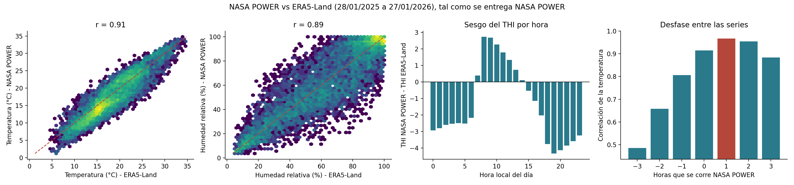
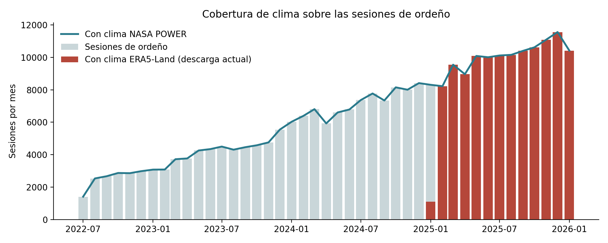
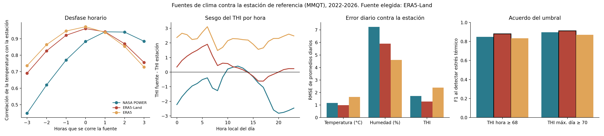

# Investigación: fuente de datos del clima del CAETEC

Fase *Data Understanding* (CRISP-DM), punto 3 del reporte de exploración: ¿de dónde obtener el clima para el proyecto? Código: [`src/DU/clima_comparacion.py`](../../src/DU/clima_comparacion.py) (primera comparación) y [`src/DU/clima_validacion.py`](../../src/DU/clima_validacion.py) (validación contra una estación y tabla final). Fecha de la investigación: 13/10/2026.

**Resultado.** El proyecto usa **una sola fuente de clima: ERA5-Land** (reanálisis de Copernicus, ≈ 11 km, servido por Open-Meteo). Gana la regla de decisión fijada antes de ver los resultados y es la candidata de mayor resolución. NASA POWER, la fuente que sugirió el socio, queda como respaldo: es una alternativa con casi la misma calidad en la dinámica diaria, pero más sesgada y de resolución más gruesa.

## 1. Pregunta y criterios

El Reporte de Business Understanding exige datos del clima "lo más precisos posible, utilizando la ubicación del rancho", y señala que el modelo usará pronósticos. Las opciones del equipo eran: 1) datos de la NASA (recomendados por el socio formador), 2) alguna API de Google, 3) otra API. El equipo pidió usar **una sola fuente** para no mezclar datos; los pronósticos directos del CAETEC que menciona el BU aún no se han entregado, así que se prioriza NASA o la fuente de mayor resolución. Criterios:

| Criterio | Por qué importa |
|---|---|
| Libre uso y compatible con el proyecto | Proyecto académico sin fines comerciales; los términos deben permitirlo |
| Cobertura de toda la serie (13/07/2022 – 28/01/2026) | La descarga previa solo cubría 28/01/2025 – 27/01/2026: el 56.4 % de las sesiones quedaba sin clima |
| Resolución horaria y espacial | Las sesiones se registran al minuto; la hora del día importa |
| Variables útiles | Temperatura y humedad (para el THI); precipitación, viento y radiación serían un extra |
| Exactitud contra mediciones reales | Un reanálisis no mide el clima: hay que contrastarlo con una estación |
| Pronóstico | El BU indica que el modelo usará pronósticos del clima |
| Almacenable | Reproducibilidad de los resultados |
| Privacidad de la ubicación | La política de uso de datos del CAETEC pide no divulgar ubicaciones |

## 2. Fuentes comparadas

| | 1) NASA POWER (horario) | 2) Google Maps Platform Weather API | 3) Open-Meteo (ERA5-Land y ERA5) |
|---|---|---|---|
| Costo y acceso | Gratuito. Sin límite fijo, el uso se monitorea y se limita para un acceso equitativo | De pago: 10,000 eventos gratis al mes y luego desde USD 0.15 por 1,000. Requiere cuenta de Google Cloud con facturación | Gratis para uso **no comercial** (menos de 10,000 llamadas al día); licencia de datos CC BY 4.0 |
| Histórico | Horario desde **2001/01/01** hasta casi tiempo real | Solo las **últimas 24 horas** | ERA5 desde 1940 y ERA5-Land desde 1950, con 5 días de retraso |
| Resolución espacial | Malla MERRA-2 de ½° × ⅝° (≈ 50 × 60 km); cada valor es el promedio de la celda | Puntual (modelo propio) | ERA5-Land ≈ 11 km; ERA5 ≈ 25 km; IFS ≈ 9 km |
| Variables | Temperatura, humedad, viento, presión, precipitación, entre otras | Condiciones actuales, pronóstico horario (240 h) y diario (10 días) | Temperatura y humedad en ERA5-Land; **viento, radiación y precipitación solo en ERA5** |
| Pronóstico | No | Sí | Sí (API de pronóstico y pronósticos archivados desde ≈ 2022) |
| Uso y citación | Pide acreditar "POWER Hourly vX.X.X" con la fecha de acceso y avisar al proyecto de las publicaciones | Atribución obligatoria; caché y almacenamiento restringidos (texto oficial por verificar) | Atribución CC BY 4.0 |

Fuentes: [NASA POWER, API horaria](https://power.larc.nasa.gov/docs/services/api/temporal/hourly/), [metodología de meteorología](https://power.larc.nasa.gov/docs/methodology/meteorology/), [evaluación de POWER contra estaciones](https://power.larc.nasa.gov/docs/methodology/meteorology/assessment/), [cómo referenciar POWER](https://power.larc.nasa.gov/docs/referencing/), [foro sobre límites de uso](https://forum.earthdata.nasa.gov/viewtopic.php?p=15146), [Google Weather API](https://developers.google.com/maps/documentation/weather), [precios de Google Maps Platform](https://developers.google.com/maps/billing-and-pricing/pricing), [términos de Open-Meteo](https://open-meteo.com/en/terms), [API histórica de Open-Meteo](https://open-meteo.com/en/docs/historical-weather-api), [API de pronósticos archivados](https://open-meteo.com/en/docs/historical-forecast-api).

### Por qué se descarta Google para entrenar

La API de Google solo guarda 24 horas de historia, así que no puede cubrir ni una sesión de las 280,699 del histórico. Además es de pago, exige facturación y sus términos limitan el almacenamiento de contenido. Solo tendría sentido como fuente de pronóstico, y para eso hay opciones gratuitas.

## 3. Primera comparación: NASA POWER contra ERA5-Land (28/01/2025 – 27/01/2026)

Se descargó la serie horaria de NASA POWER (temperatura a 2 m, humedad relativa a 2 m, precipitación corregida y viento a 10 m) para todo el periodo de las sesiones y se comparó con la descarga de ERA5-Land del estudio de factibilidad en las 8,784 horas que ambas fuentes comparten. Para la consulta se usó el **centro de la celda de la malla de POWER**, no la ubicación exacta del establo.

| Resultado | Valor |
|---|---|
| Horas descargadas de NASA POWER | 31,151 (12/07/2022 – 29/01/2026), sin faltantes en temperatura ni humedad |
| Sesiones de ordeño con clima | **100 %** con NASA POWER frente a **43.6 %** con la descarga original de ERA5-Land (solo un año) |
| Correlación horaria de la temperatura (tal como se entrega) | 0.915 |
| Correlación de promedios diarios (temperatura, humedad, THI) | 0.968, 0.947, 0.970 |
| Sesgo de la temperatura (NASA POWER − ERA5-Land) | −0.86 °C |
| Sesgo del THI | −1.37 |
| Horas con THI ≥ 68 | 19.8 % (NASA POWER) frente a 20.8 % (ERA5-Land) |





Esa comparación mide qué tanto se parecen dos reanálisis entre sí, no cuál se acerca más a la realidad. Por eso se añadió la validación de la sección 4.

## 4. Validación contra una estación observada

### 4.1 Diseño

- **Referencia:** observaciones METAR de la estación del aeropuerto de Querétaro (MMQT), del archivo ASOS del [Iowa Environmental Mesonet](https://mesonet.agron.iastate.edu/request/download.phtml). Se descargaron 30,847 observaciones (06/07/2022 – 28/01/2026) con temperatura y humedad. Es una medición real, pero de otro punto que el establo y a otra elevación (1,813 m según el archivo; el punto de ERA5-Land usado está a 1,913 m). La estación **solo valida y no entra al dataset**.
- **Candidatas:** NASA POWER (≈ 50 km), ERA5-Land (≈ 11 km) y ERA5 (≈ 25 km), todas con cobertura del 100 % de las 280,699 sesiones y sin faltantes de temperatura ni humedad.
- **Alineación:** cada fuente se interpola linealmente en el instante exacto de cada observación. Antes se busca el desfase horario (de −3 a +3 h) que maximiza la correlación de la temperatura, porque POWER entrega promedios horarios y los reanálisis valores instantáneos.
- **Métricas:** sesgo (fuente − estación), error absoluto medio (MAE), RMSE, RMSE sin el sesgo medio y correlación de Pearson, por hora y por promedios diarios (días con al menos 18 observaciones: 1,299). También el acuerdo en el cruce del umbral de estrés térmico: sensibilidad, precisión y F1 de THI ≥ 68 por hora y de THI máximo del día ≥ 70.
- **Regla de decisión (fijada antes de ver los resultados):** se mantiene NASA POWER, salvo que otra candidata reduzca al menos **10 %** el RMSE del THI diario medio y **no empeore** el F1 del umbral horario de THI.

### 4.2 Resultados

| | NASA POWER | ERA5-Land | ERA5 |
|---|---:|---:|---:|
| Desfase que mejor alinea | **+1 h** | 0 h | 0 h |
| Correlación horaria de la temperatura, sin desfase → con desfase | 0.884 → **0.943** | 0.962 | 0.973 |
| Temperatura horaria: sesgo / RMSE (°C) | −0.73 / 2.23 | +0.27 / **1.73** | +1.52 / 2.07 |
| Humedad horaria: sesgo / RMSE (puntos) | +3.0 / 13.0 | +3.2 / 10.0 | +1.7 / 8.4 |
| THI horario: sesgo / RMSE | −1.10 / 3.02 | +0.45 / **2.31** | +2.24 / 2.94 |
| **THI diario medio: RMSE** | 1.72 | **1.29** | 2.39 |
| THI diario medio: RMSE sin sesgo | 1.32 | 1.21 | **0.86** |
| THI diario medio: correlación | 0.953 | 0.961 | **0.980** |
| F1 de THI horario ≥ 68 (sensibilidad / precisión) | 0.849 (0.80 / 0.91) | **0.879** (0.86 / 0.90) | 0.833 (0.99 / 0.72) |
| F1 de THI máximo del día ≥ 70 | 0.897 | **0.911** | 0.870 |



### 4.3 Decisión

**ERA5-Land.** Reduce 25 % el RMSE del THI diario medio frente a NASA POWER (1.29 contra 1.72), supera la regla (≥ 10 %) y mejora el F1 del umbral (0.879 contra 0.849). También es la candidata de mayor resolución entre las que cubren todo el periodo y se queda con una sola fuente. NASA POWER conserva ventajas (es la sugerida por el socio y entrega precipitación y viento), pero su celda es más gruesa y su sesgo del THI es negativo (−1.10).

Tres matices que conviene dejar claros:

1. **El desfase de +1 h de NASA POWER queda confirmado** por una estación independiente (la correlación sube de 0.884 a 0.943), no solo por la comparación con otro reanálisis.
2. **ERA5 (25 km) tiene la mejor correlación y el menor error sin sesgo**, pero un sesgo cálido de +2.2 de THI que el criterio de RMSE penaliza. Un modelo de árboles o una regresión absorben un sesgo constante, pero los umbrales de la literatura (THI 68 o 72) exigen el nivel absoluto. Si se quisiera usar ERA5, habría que corregir el sesgo con una estación; por ahora no se hace.
3. **La estación no es el establo.** Las métricas dicen qué tan bien cada fuente reproduce el clima regional medido en otro punto, no el microclima junto a las vacas.

### 4.4 Qué se pierde con esta decisión

ERA5-Land por Open-Meteo **solo entrega temperatura y humedad**: la precipitación, el viento y la radiación solar llegan 100 % nulos (se comprobó en las 8,760 horas de un bloque anual). El dataset de clima queda entonces con temperatura, humedad y THI, que son las variables con base en la literatura para estrés térmico. Si más adelante se necesitaran lluvia, viento o radiación, habría que consultar ERA5 o el servicio de Copernicus (requiere cuenta), o NASA POWER, y eso rompería la regla de una sola fuente.

## 5. Tabla de clima integrada

`clima_validacion.py` deja la tabla `Data/clima/clima_horario.csv` (fuera de Git): una fila por hora local (`America/Mexico_City`), del 05/07/2022 al 29/01/2026, con 31,295 horas continuas y sin faltantes en temperatura y humedad. Contiene, además del clima por hora (`t2m`, `rh2m`, `thi`), variables que solo usan información anterior a la hora consultada:

| Variable | Definición |
|---|---|
| `horas_thi_alto_24h`, `horas_thi_alto_48h` | Horas con THI ≥ 68 en las 24 y 48 horas anteriores |
| `thi_max_dia_previo`, `thi_medio_dia_previo`, `thi_min_dia_previo` | THI máximo, medio y mínimo del día anterior |
| `amplitud_t_dia_previo` | Temperatura máxima menos mínima del día anterior |
| `thi_medio_rezago_1d` a `thi_medio_rezago_4d` | THI medio de 1, 2, 3 y 4 días antes (la literatura reporta efectos de 1 a 4 días sobre la producción) |

El THI se calcula con `THI = (1.8 T + 32) − (0.55 − 0.0055 · HR) · (1.8 T − 26)`. Cada sesión se une a su fila por la hora de inicio. Las horas repetidas por el cambio de horario de verano de octubre de 2022 se promedian. Falta confirmar con el socio formador si el reloj del sistema de ordeño siguió ese horario de verano (hasta el 30/10/2022).

## 6. Riesgos y cómo mitigarlos

1. **Cambio de fuente entre entrenamiento y despliegue.** Entrenar con ERA5-Land y operar con el pronóstico de Open-Meteo usa el mismo proveedor, pero otro modelo. Mitigación: entrenar con variables suavizadas (THI máximo o medio del día, horas acumuladas) y evaluar el modelo con pronósticos archivados antes de desplegar. Queda sujeto a la respuesta del socio sobre los pronósticos del CAETEC.
2. **Resolución gruesa.** El punto de ≈ 11 km no distingue el microclima del establo. El THI bajo techo, con sombra o con aspersores será distinto del exterior.
3. **Reanálisis, no medición.** Ninguna de las series mide el clima junto a las vacas; la estación de referencia es un solo punto (aeropuerto) y falta contrastar con una segunda estación o con sensores del establo.
4. **Humedad con sesgo.** La humedad de ERA5-Land tiene un sesgo de +3.2 puntos y un RMSE horario de 10 puntos; esto afecta al THI sobre todo de noche.
5. **Estabilidad de los datos.** Open-Meteo y el reanálisis pueden reprocesar valores. Se guardan las respuestas originales (`Data/clima/`) y la fecha de acceso.

## 7. Uso, citación y privacidad

- **ERA5-Land y Open-Meteo.** Los datos son CC BY 4.0: en cualquier entregable se cita a Open-Meteo y a Copernicus/ERA5-Land como origen. Fecha de acceso: 13/10/2026.
- **Estación de referencia.** Observaciones del archivo ASOS/METAR del Iowa Environmental Mesonet (Iowa State University), estación MMQT; fecha de acceso: 13/10/2026. Se usan solo para validar.
- **NASA POWER (respaldo y comparación).** Si se usa en un entregable: *"The data was obtained from the POWER Project's Hourly 2.x.x version on YYYY/MM/DD"*, más la referencia al proyecto POWER del Langley Research Center (texto vigente en la [página de referencias](https://power.larc.nasa.gov/docs/referencing/)). Versión consultada: v2.10.2; acceso 13/10/2026. POWER pide avisar de las publicaciones a `larc-power-project@mail.nasa.gov`.
- **Ubicación.** La política de uso de datos del CAETEC pide no divulgar ubicaciones. Las consultas usaron puntos de malla (celdas de 0.1° y de ½° × ⅝°), no la ubicación exacta del establo, y los documentos del repositorio no publican las coordenadas del rancho.
- **Datos locales.** Las respuestas originales y las series procesadas están en `Data/clima/`, fuera del control de versiones.

## 8. Cómo reproducirlo

```bash
python src/DU/clima_comparacion.py   # primera comparación NASA POWER y ERA5-Land (usa red)
python src/DU/clima_validacion.py    # validación contra la estación, decisión y tabla final (usa red)
```

Ambos scripts guardan las respuestas originales en `Data/clima/` y no las vuelven a pedir si ya existen. Requieren `numpy`, `pandas`, `matplotlib` y `requests`.

## 9. Pendientes

- Confirmar con el socio formador que "datos de la NASA" se refiere a NASA POWER, y si el CAETEC tiene estación meteorológica o sensores de temperatura y humedad en el establo (permitiría validar el clima real junto a las vacas).
- Confirmar con el socio qué son los pronósticos "directos del CAETEC" del BU y si existe su histórico.
- Validar también contra una estación del SMN/CONAGUA (la búsqueda inicial no halló el portal con serie horaria).
- Decidir si el modelo se desplegará con pronóstico o con clima observado, y validar el pronóstico archivado de Open-Meteo.
- Verificar el texto vigente de los términos de Google Weather API sobre almacenamiento y los límites actuales de NASA POWER.
