# Reporte de exploración de datos

Fase *Data Understanding* (CRISP-DM). Cubre cuatro puntos: visualizar y consultar los datos, visualizar patrones y distribuciones, integrar datos del clima e identificar hipótesis iniciales. La elección de la fuente de clima está en [Investigacion_Clima.md](Investigacion_Clima.md); las fórmulas y la lectura de cada técnica, en el [Anexo](#anexo-marco-estadístico).

**Objetivo de negocio:** detectar de forma temprana anomalías en el ordeño. **Objetivo de minería de datos:** clasificar el tipo de evento de ordeño (patada, ordeño incompleto, pezón no encontrado).

> Los resultados son exploratorios: describen asociaciones y no demuestran causas. Las vacas y los robots se muestran con el hash HMAC de 8 caracteres de `anonymize_data.py`; el mapa para traducirlos queda en `Data/`, fuera del repositorio.

## 1. Datos y método

| Elemento | Detalle |
|---|---|
| Tabla base | Dataset anonimizado **`vacas/3.0`** (`generate_data.py` + `anonymize_data.py`): **280,699 sesiones de 207 vacas**, del 13/07/2022 al 28/01/2026. Una fila es una sesión de ordeño de una vaca en un robot (VMS). Se usan los xlsx de producción y, de los CSV de marzo a junio de 2025, solo los ordeños de las vacas que no tienen xlsx (el resto repite sesiones de los xlsx) |
| Clima | **NASA POWER horario** (API v2.10.2, comunidad AG, descargado el 15/10/2026 con `descargar_clima.py`), fuente única elegida por el equipo; 100 % de las sesiones con clima (ver [Investigacion_Clima.md](Investigacion_Clima.md)) |
| Código | [`src/DU/exploracion_datos.py`](../../src/DU/exploracion_datos.py) (primera exploración) y [`src/DU/exploracion_profunda.py`](../../src/DU/exploracion_profunda.py) (profundización y PCA); el clima sale de [`src/DU/descargar_clima.py`](../../src/DU/descargar_clima.py) |
| Datos | Fuera del repositorio (`Data/`), según la política de uso de datos. Todas las figuras de `figuras/` se generaron con `vacas/3.0` y NASA POWER v2.10.2 |

**Variables.** Por sesión: producción (`milk_kg`), duración, intervalo desde el ordeño anterior, número de sesión del día, y por cuarto de la ubre (DI, DD, TI, TD) la producción, el flujo, la sangre y la conductividad; además `mdi`, el robot (`machine`), el destino de la leche y tres banderas binarias: `kick` (patada), `incomplete` (ordeño incompleto) y `teat_missing` (pezón no encontrado). El diccionario completo está en la sección 2.3.

### 1.1 Qué cambió respecto a la versión anterior

Esta versión rehace la exploración con dos insumos nuevos del equipo. Las conclusiones de ordeño se mantienen; cambian el clima y algunos detalles:

| Cambio | Efecto en los resultados |
|---|---|
| La tabla base pasa de una tabla normalizada propia (con alias `V001…`) al dataset anonimizado `vacas/3.0` del equipo | Las 280,699 sesiones y 207 vacas coinciden. Los alias de vaca y los nombres «VMS 1 a 3» se sustituyen por hashes |
| Los intervalos de 24 h o más vienen en Excel como fecha (1900-01-01 equivale a 24 h); la tabla anterior solo conservaba la hora y los convertía en intervalos cortos | Hay **2,337 sesiones con intervalo de 24 a 48 h** que antes parecían de 0 a 24 h. Los **185 intervalos de más de 48 h** (hasta 122 días) son regresos tras una brecha y se tratan como faltantes. El intervalo deja de tener «tope de 24 h», el logaritmo ya no lo sobrecorrige y los incompletos con intervalo menor a 4 h suben de 25.9 % a **28.2 %** (H6) |
| El clima pasa de ERA5-Land (≈ 11 km, solo temperatura y humedad) a NASA POWER (celda de ½° × ⅝°, 13 variables) | H1 y H2 dan casi lo mismo. El PCA del clima diario ya no es de dos dimensiones: el **viento** forma un tercer componente propio |
| Se quitan las fuentes auxiliares (consumo, historiales y reportes del 18/07/2025), que no forman parte del dataset anonimizado | Salen los resultados de consumo, acciones rechazadas, periodo seco, días en leche y reporte de patadas |

## 2. Visualizar y consultar los datos

### 2.1 Resumen de volumen y calidad

| Indicador | Resultado |
|---|---|
| Sesiones por vaca | Mediana 1,264 (mínimo 2, máximo 3,569); 3 vacas con menos de 30 sesiones |
| Sesiones por robot | `74bb9015`: 97,643 · `b9823abe`: 91,649 · `97a5ee28`: 91,405 · `53bc377b`: 2 (un cuarto valor de máquina con solo 2 sesiones y sin eventos) |
| Destino de la leche | Tanque 94.4 % · Drenaje 3.7 % · Divert 3 1.9 % (Divert 1 y 2: 7 sesiones) |
| Duplicados (misma vaca y hora) | 0 |
| Producción ≤ 0 kg / > 40 kg | 166 / 55 sesiones |
| Duración > 30 min | 31 sesiones |
| Intervalo ≤ 0 h / de 24 a 48 h / > 48 h | 403 / 2,337 / 185 sesiones (las de más de 48 h se tratan como faltantes) |
| Suma de cuartos distinta del total (> 0.2 kg) | 9 sesiones |
| Brechas de 45 días o más sin registros | 249 brechas en 134 vacas (periodos secos, ver 3.3) |
| Variable vacía | `rcs` (conteo de células somáticas): 100 % nula, no utilizable |
| Nulos en variables por cuarto | 1.6 % a 3.9 %; `mdi` 8.4 %; `interval_h` 0.7 % (incluye los 185 intervalos de más de 48 h) |

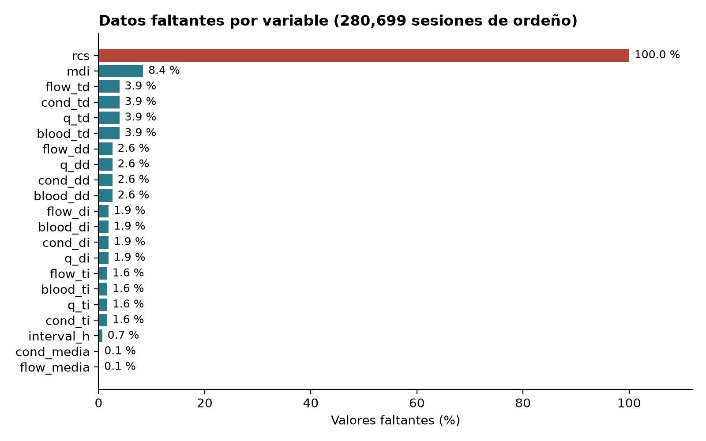

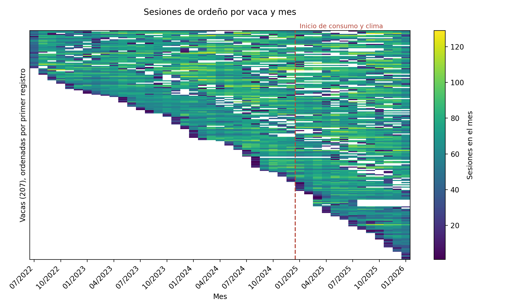

**Ceros que en realidad son faltantes.** La conductividad de la leche no puede ser 0. Hay ceros en el 1.7 % (DI), 3.2 % (DD), 8.3 % (TI) y 28.3 % (TD) de las sesiones. En TD casi todos vienen de un solo robot: **el robot `74bb9015` tiene conductividad TD igual a 0 en el 72.3 % de sus sesiones** frente al 5.2 % y 4.3 % de `b9823abe` y `97a5ee28`, lo que apunta a un sensor averiado en ese cuarto y robot. En los demás casos el cero coincide con un cuarto que no dio leche (producción 0 kg en el 1.6 %, 1.5 %, 4.6 % y 4.7 % de las sesiones para DI, DD, TI y TD). Para análisis, la conductividad y el flujo en 0 se tratan como faltantes.

**Los faltantes no son aleatorios.** El 10.2 % de las sesiones tiene al menos un cuarto con 0 kg. Ese porcentaje es del **71.3 %** entre los ordeños incompletos (1.9 % entre los demás) y del **86.7 %** entre los de pezón no encontrado (0.0 % entre los demás); en las patadas es 12.7 % contra 9.7 %. Un cuarto sin leche es, en buena parte, la huella de esos dos eventos, así que no debe imputarse sin más.

### 2.2 Consultas de ejemplo

```python
leche.groupby("machine")[["kick", "incomplete", "teat_missing"]].mean() * 100   # eventos por robot
leche[leche["incomplete"] == 1]["milk_kg"].median()                             # leche en ordeños incompletos
leche.groupby("animal_id")["kick"].mean().sort_values(ascending=False).head()   # vacas con más patadas
leche[(leche["interval_h"] < 4)]["incomplete"].mean()                           # incompletos con intervalo corto
```

| Consulta | Resultado |
|---|---|
| Mediana de leche en un ordeño incompleto frente a uno completo | 9.7 kg frente a 14.9 kg; duración mediana de 9.5 min frente a 7.4 min |
| Vacas con patada en más del 40 % de sus sesiones | 12 vacas (las dos primeras, `91f233b4` y `0a52c8c4`, superan el 85 %) |
| Sesiones con menos de 0.5 h desde el ordeño anterior | 603 (0.2 %); 16.9 % de ellas es incompleta |

### 2.3 Diccionario de variables

| Variable | Tipo | Unidad | Descripción | Nulos | Mediana | p1 a p99 |
|---|---|---|---|---:|---:|---|
| `timestamp` | Fecha-hora | hora local | Inicio de la sesión de ordeño | 0 % | — | — |
| `animal_id` | Identificador | — | Vaca (hash HMAC de 8 caracteres) | 0 % | — | — |
| `milk_kg` | Numérica continua | kg | Leche de la sesión | 0 % | 14.29 | 3.91 a 29.27 |
| `session_no` | Discreta | — | Número de sesión del día | 0 % | 2 | 1 a 4 |
| `duration_min` | Numérica continua | min | Duración de la sesión | 0 % | 7.60 | 4.23 a 16.07 |
| `interval_h` | Numérica continua | h | Tiempo desde el ordeño anterior (más de 48 h se trata como faltante) | 0.7 % | 9.07 | 3.59 a 23.30 |
| `q_*` | Numérica continua | kg | Leche por cuarto (DI, DD, TI, TD) | 2.5 % | 3.66 | 0 a 8.89 |
| `flow_*` | Numérica continua | kg/min | Flujo por cuarto | 2.5 % | 1.14 | 0 a 2.28 |
| `blood_*` | Numérica continua | ppm | Sangre por cuarto | 2.5 % | 0 | 0 a 463 |
| `cond_*` | Numérica continua | mS/cm | Conductividad por cuarto | 2.5 % | 4.85 | 0 a 6.38 |
| `mdi` | Numérica continua | sin unidad documentada | Índice del robot | 8.4 % | 1.10 | 1.00 a 2.99 |
| `rcs` | Numérica continua | — | Conteo de células somáticas | 100 % | — | — |
| `machine` | Categórica (4) | — | Robot de ordeño (hash HMAC; 3 robots y un valor con 2 sesiones) | 0 % | — | — |
| `destination` | Categórica (5) | — | Destino de la leche (Tanque, Drenaje, Divert 1 a 3) | 0 % | — | — |
| `kick`, `incomplete`, `teat_missing` | Binaria | 0/1 | Patada, ordeño incompleto, pezón no encontrado | 0 % | — | — |

Las columnas con asterisco agrupan los cuatro cuartos; sus nulos, mediana y percentiles se calculan sobre los cuatro juntos.

### 2.4 Diagrama de pares

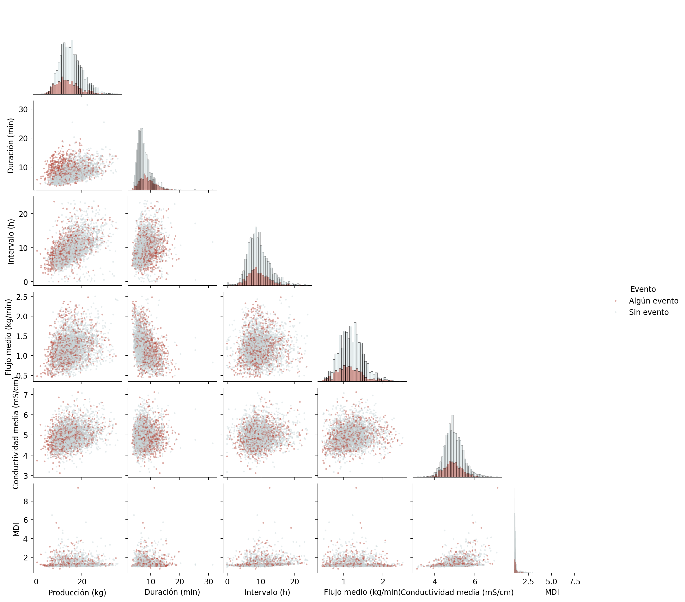

Sobre una muestra aleatoria de 4,000 sesiones (todas serían ilegibles), las sesiones con algún evento (rojo) se **traslapan casi por completo** con las demás en cada par de variables. Se ve que la producción sube con el intervalo, que la duración baja con el flujo, que el MDI casi no varía (pegado a 1.0 con una cola larga) y que la conductividad se mueve alrededor de 5 mS/cm. Ningún par separa los eventos a simple vista, lo que anticipa correlaciones débiles (sección 3.6).

## 3. Visualizar patrones y distribuciones

### 3.1 Distribuciones de las variables numéricas

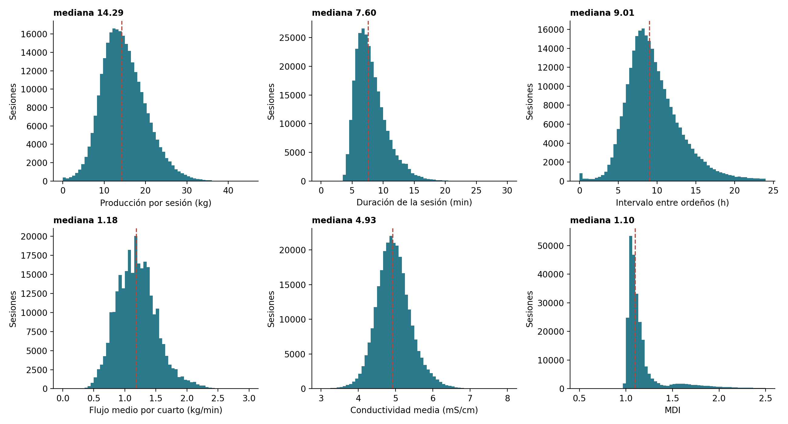

| Variable | Mediana | Observación |
|---|---:|---|
| Producción por sesión (kg) | 14.29 | Forma de campana con cola derecha |
| Duración (min) | 7.60 | Sesgo a la derecha; casi no hay sesiones de menos de 4 min |
| Intervalo entre ordeños (h) | 9.07 | Cola derecha que pasa de 24 h (2,337 sesiones de 24 a 48 h); hay un pico pequeño cerca de 0 h (403 sesiones con intervalo de 0 h o menos) |
| Flujo medio por cuarto (kg/min) | 1.18 | Valores discretos por la resolución del sensor |
| Conductividad media (mS/cm) | 4.93 | Casi simétrica, dentro del rango fisiológico |
| MDI | 1.10 | Muy concentrada en 1.0–1.2 con una cola larga y un tope en 2.5 |

**Media contra mediana, y dispersión.** En las tres variables con cola derecha la media queda por encima de la mediana: producción 14.82 contra 14.29 kg (+3.7 %), duración 8.10 contra 7.60 min (+6.5 %) e intervalo 9.77 contra 9.07 h (+7.7 %). La diferencia es pequeña, así que la mediana es el valor típico más honesto. Para la dispersión se comparan la desviación estándar y el IQR (rango entre el cuartil 1 y el 3): producción 5.34 kg y 7.03 kg (11.07 a 18.10), duración 2.58 y 3.15 min (6.25 a 9.40), intervalo 3.87 y 4.23 h (7.27 a 11.50). Con el criterio de 1.5 × IQR resultan atípicos el 1.37 % de las producciones (341 bajos y 3,508 altos), el 2.74 % de las duraciones (casi todos largos: 7,669) y el 3.77 % de los intervalos (657 bajos y 9,848 altos). Los atípicos se marcan y no se eliminan, porque los ordeños muy largos o de intervalo muy corto son justo los que pueden contener eventos.

**Efecto del logaritmo.**

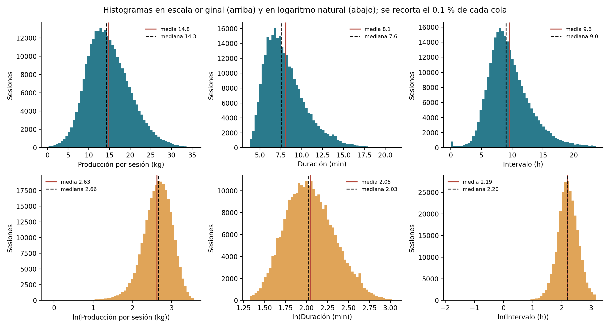

El logaritmo natural simetriza la **duración** (media 2.046 y mediana 2.028 en logaritmo) y el **intervalo** (2.209 contra 2.206), pero **sobrecorrige** la producción: en escala original tenía una cola derecha ligera y en logaritmo la cola pasa a la izquierda (media 2.623 por debajo de la mediana 2.660). Por eso la duración y el intervalo se benefician de transformarse; la producción se deja en su escala. En la versión anterior el intervalo parecía sobrecorregido, pero era efecto de haber convertido los intervalos de más de 24 h en intervalos cortos. Las 166 producciones ≤ 0 y los 403 intervalos ≤ 0 no tienen logaritmo y quedan fuera de esas gráficas.

**Escala temporal.**

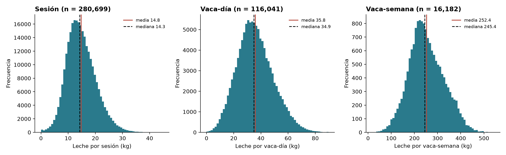

A diferencia de un retorno diario contra uno mensual, agregar la producción cambia poco la forma: sigue siendo una campana con una cola derecha ligera. Por sesión la media (14.82 kg) supera a la mediana (14.29) en 3.7 %; por vaca-día (n = 116,041; media 35.84 y mediana 34.87 kg) y por vaca-semana (n = 16,182, solo semanas con 6 o más días observados; media 252.4 y mediana 245.4 kg) la diferencia baja a 2.8 %. Lo que cambia es la lectura: una vaca-día suma 1 sesión en el 10.4 % de los casos, 2 en el 45.5 %, 3 en el 36.4 %, 4 en el 7.3 % y 5 o más en el 0.4 %, de modo que la dispersión diaria (desviación de 13.27 kg) mezcla diferencias de producción con diferencias en el número de visitas.

### 3.2 Patrones temporales

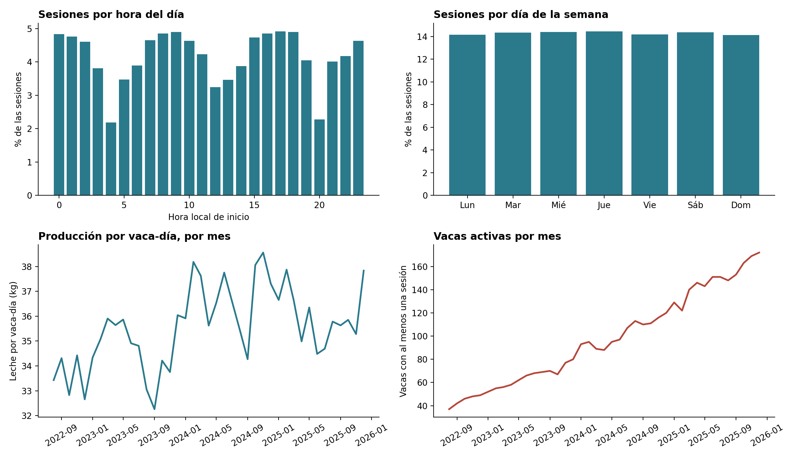

- **Hora del día:** las visitas se reparten durante las 24 horas (el voluntario no tiene horario fijo), con caídas marcadas a las **04 h (2.2 %), 12–13 h (≈ 3.2 %) y 20 h (2.3 %)** frente a ≈ 4.8 % en las horas pico. Podrían corresponder a ciclos de limpieza del robot; se debe confirmar con el socio formador.
- **Día de la semana:** sin diferencias (14.1 % a 14.5 % por día).
- **Sesiones por vaca-día:** mediana 2, media 2.42, máximo 6. Producción mediana por vaca-día de 34.9 kg.
- **Mes a mes:** la producción por vaca-día se mueve entre 32.3 y 38.6 kg sin una estacionalidad anual clara. El hato crece de 37 a 172 vacas activas, por lo que la composición de lactancias cambia con el tiempo y confunde cualquier tendencia.

**Los eventos en el tiempo y su incertidumbre.**

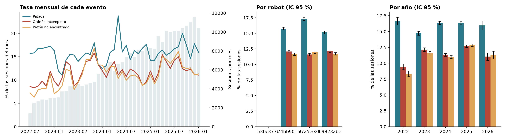

La tasa mensual de cada evento oscila bastante (patada de 11.1 % a 23.8 %, incompleto de 8.3 % a 15.8 %, pezón no encontrado de 6.3 % a 16.8 %), en parte porque algunos meses tienen pocas sesiones. Con el intervalo de confianza de 95 % de una proporción (p ± 1.96 · EE) se ve que:

- **Robot:** la patada es más frecuente en `97a5ee28` (17.3 % ± 0.25) que en `74bb9015` (15.8 % ± 0.23) y `b9823abe` (15.2 % ± 0.23), y los intervalos no se traslapan; en ordeño incompleto y pezón no encontrado las diferencias son de menos de un punto.
- **Año:** el ordeño incompleto y el pezón no encontrado **suben** de 9.5 % y 8.3 % en 2022 (± 0.5) a 12.7 % y 12.9 % en 2025 (± 0.2), con intervalos que no se traslapan; la patada se mantiene entre 14.7 % y 16.7 %. Hay deriva en dos de los tres eventos, lo que importa al partir los datos en entrenamiento y prueba.
- Estos intervalos suponen sesiones independientes y son optimistas, porque las sesiones de una misma vaca se parecen entre sí (sección 3.7).

### 3.3 Curva de lactancia aproximada

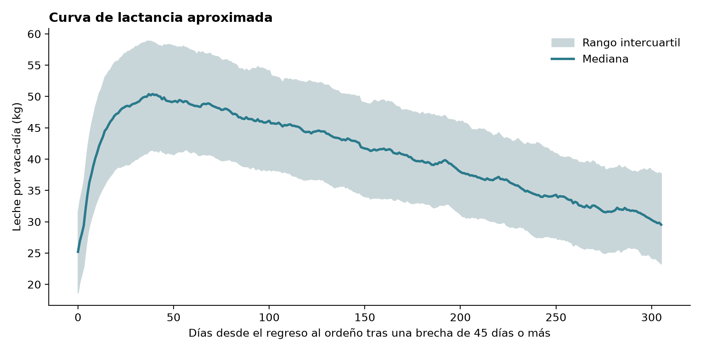

Con 249 episodios que reinician tras una brecha de 45 días o más, la mediana alcanza su pico hacia el **día 39 con 50.4 kg por vaca-día** y baja a 34.1 kg hacia el día 250. El rango intercuartil es amplio (± 8 kg en el pico), por lo que la etapa de lactancia explica mucha variación entre vacas. No hay fecha de parto en los datos de ordeño, así que los días se miden desde el regreso al ordeño. La aproximación no está validada contra una fecha de parto: los reportes del 18/07/2025 que la respaldaban en la versión anterior quedaron fuera del dataset anonimizado.

### 3.4 Cuartos y robots

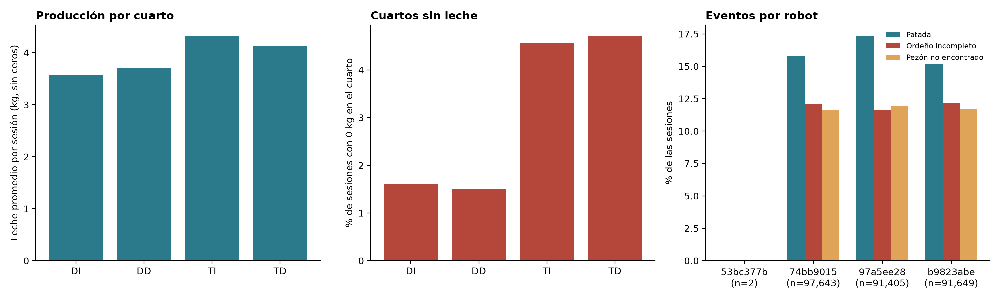

- **Cuartos traseros:** producen más leche cuando dan leche (TI 4.32 kg y TD 4.13 kg frente a DI 3.57 kg y DD 3.70 kg), pero tienen 3 veces más sesiones con 0 kg (4.6 % y 4.7 % frente a 1.6 % y 1.5 %).
- **Robots:** las tasas de eventos son parecidas. Patada: 15.8 %, 15.2 % y 17.3 % (`74bb9015`, `b9823abe` y `97a5ee28`). Ordeño incompleto: 12.1 %, 12.2 % y 11.6 %. Pezón no encontrado: 11.6 %, 11.7 % y 12.0 %. La prueba chi-cuadrada sale significativa en patada y en incompleto por el tamaño de la muestra, pero el tamaño del efecto es mínimo (V de Cramér de 0.025 y 0.008).

### 3.5 Eventos objetivo

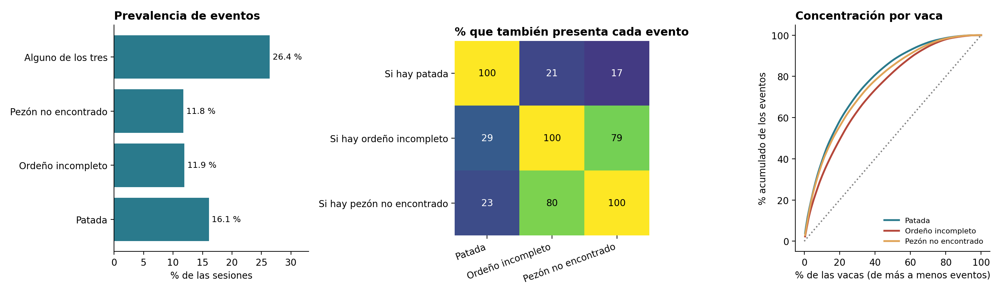

| Evento | Prevalencia | % de los eventos concentrado en el 10 % de las vacas con más eventos |
|---|---:|---:|
| Patada | 16.1 % | 38.0 % |
| Ordeño incompleto | 11.9 % | 30.8 % |
| Pezón no encontrado | 11.8 % | 36.9 % |
| Alguno de los tres | 26.4 % | — |

- **Desbalance moderado:** ninguna clase baja del 11 %. El criterio de accuracy ≥ 70 % se supera sin esfuerzo con una clase que domina (73.6 % de sesiones sin ningún evento), por lo que habrá que reportar también precisión, exhaustividad y F1 por clase.
- **`incomplete` y `teat_missing` casi son el mismo evento:** el 79 % de los ordeños incompletos tiene pezón no encontrado, el 80 % de los pezones no encontrados es incompleto y su correlación de Spearman es de **0.77**. Usar uno como variable para predecir el otro sería fuga de información.
- **Las patadas son otro fenómeno:** solo el 21 % de las patadas coincide con un ordeño incompleto.
- **Concentración por vaca:** el 10 % de las vacas aporta alrededor de un tercio de cada evento. La identidad de la vaca es una señal fuerte, y es un riesgo si el modelo debe generalizar a vacas nuevas.

### 3.6 Correlaciones

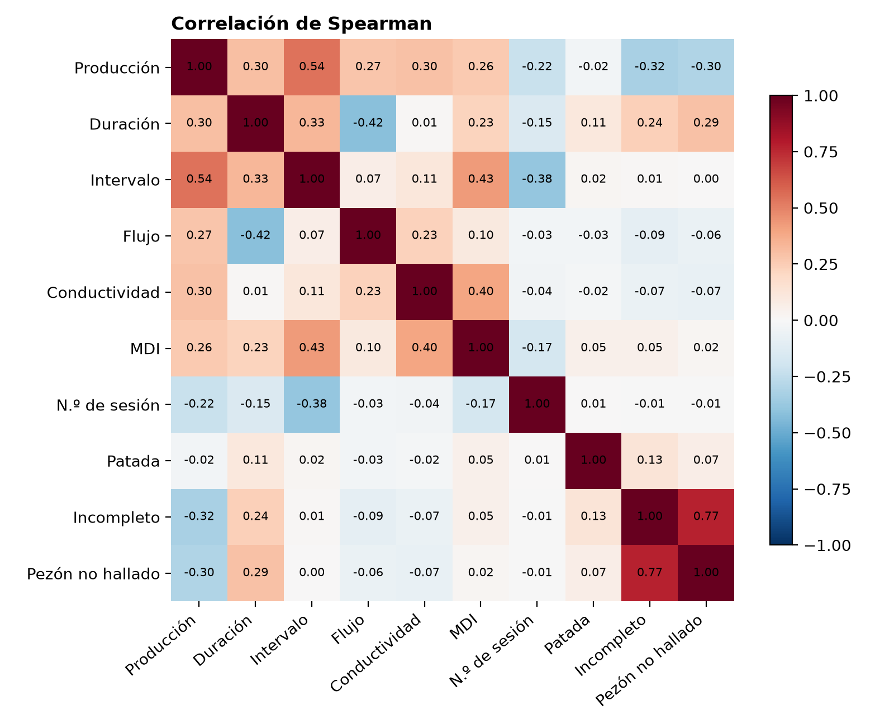

La producción se asocia sobre todo con el intervalo desde el ordeño anterior (Spearman 0.54), y también con la duración (0.30), la conductividad (0.30) y el flujo (0.27). Los ordeños incompletos producen menos (−0.32) y duran más (0.24). El intervalo no se correlaciona linealmente con la bandera de incompleto (0.01), pero la relación no es lineal (ver H6 en la sección 5).

**Covarianza, Pearson, R² y significancia.**

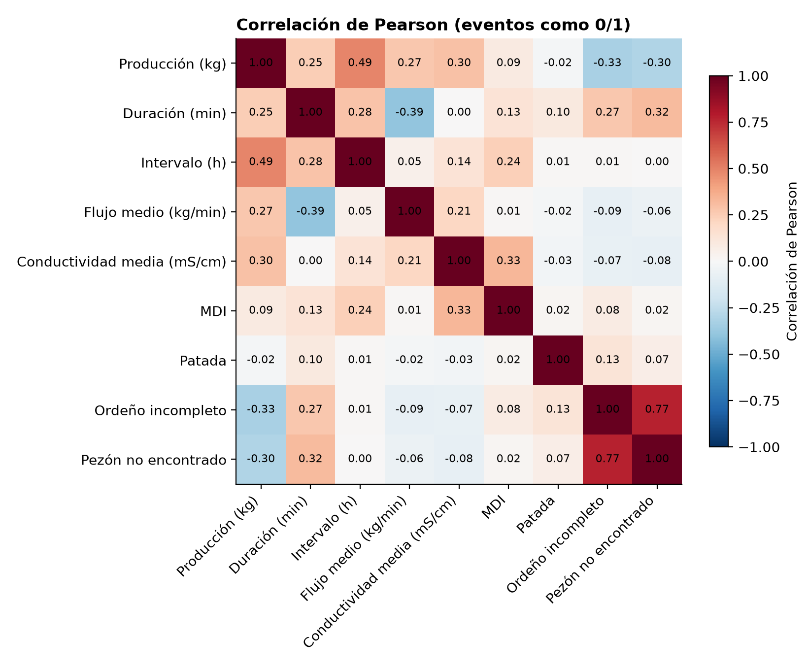

La tabla completa de los 33 pares con covarianza, correlación, R², estadístico t y p-value está en `Data/eda/correlaciones_significancia.csv`. Los pares con mayor correlación son:

| Par | n | Covarianza | r de Pearson | R² | t |
|---|---:|---:|---:|---:|---:|
| Producción e intervalo | 278,783 | 10.13 | 0.491 | 0.241 | 297 |
| Duración y flujo medio | 280,533 | −0.33 | −0.394 | 0.155 | −227 |
| Conductividad media y MDI | 257,192 | 0.064 | 0.329 | 0.108 | 177 |
| Producción e incompleto | 280,699 | −0.57 | −0.327 | 0.107 | −183 |
| Duración y pezón no encontrado | 280,699 | 0.27 | 0.320 | 0.103 | 179 |
| Producción y pezón no encontrado | 280,699 | −0.52 | −0.302 | 0.091 | −168 |

Con tantas filas casi todo es «significativo»: **31 de los 33 pares tienen p < 0.001**. Por eso importa el tamaño de r. Con la patada, la correlación más alta es la de la duración (r = 0.10, R² = 0.010): una sola variable de la sesión explica el 1 % de la variación de las patadas. Con el ordeño incompleto y el pezón no encontrado, el R² máximo es 0.107 y 0.103 (producción y duración, que además se miden en la misma sesión).

**Multicolinealidad.** El factor de inflación de la varianza (VIF) de las seis variables agregadas va de 1.21 (MDI) a 1.91 (producción), y el de las doce variables por cuarto, de 1.28 a 2.74 (conductividad DI y DD), todos muy por debajo del umbral de 5. Los cuatro cuartos se parecen entre sí, pero no al punto de ser redundantes. Sí conviene conservar la regla de no meter a la vez `incomplete` y `teat_missing` (sección 3.5).

### 3.7 Persistencia: ¿un evento anticipa el siguiente?

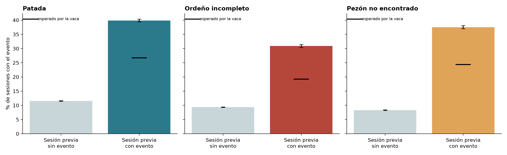

Entre sesiones consecutivas de la misma vaca (a menos de 24 h, n = 277,628), la probabilidad de un evento sube mucho si la sesión anterior tuvo el mismo evento:

| Evento | Si la sesión previa no tuvo el evento | Si la previa lo tuvo | Esperado si solo importara la vaca |
|---|---:|---:|---:|
| Patada | 11.5 % | **39.9 %** | 26.7 % |
| Ordeño incompleto | 9.4 % | **30.9 %** | 19.2 % |
| Pezón no encontrado | 8.3 % | **37.5 %** | 24.4 % |

La razón entre columnas es de 3.3 a 4.5 veces. Parte de esa subida se debe a que hay vacas con muchos eventos. Para separar el efecto, la tercera columna es la tasa que se esperaría si lo único que importara fuera la tasa propia de cada vaca (promedio de la tasa de cada vaca, ponderado por las sesiones que siguen a un evento). **La probabilidad observada sigue 1.5 a 1.6 veces por encima de lo esperado**: los eventos se agrupan en el tiempo más allá de la identidad de la vaca. Una parte puede ser el reintento del robot tras un ordeño incompleto (pregunta pendiente al socio). Para una alerta temprana, el historial reciente de la vaca es probablemente el mejor candidato a predictor.

### 3.8 Adaptación al robot

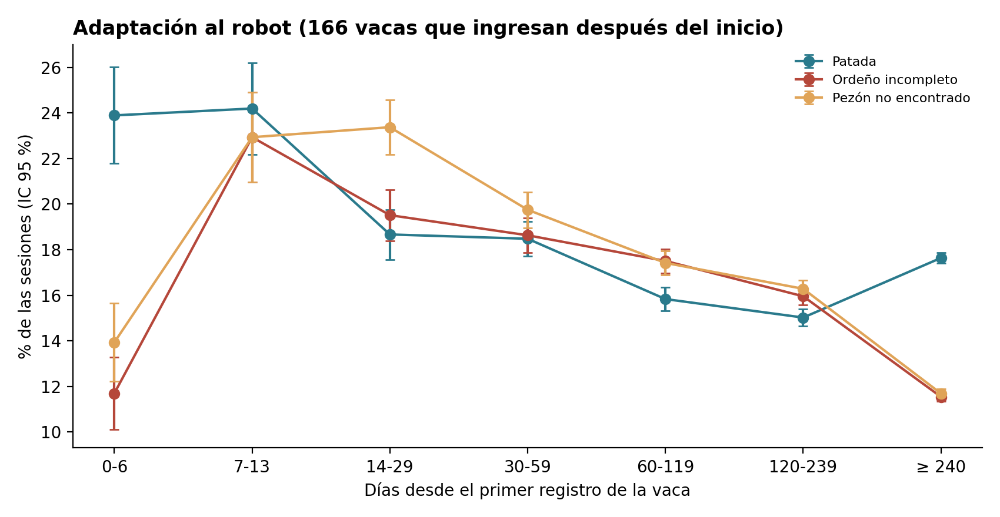

Con las 166 vacas cuyo primer registro es posterior a los 60 primeros días de los datos (174,310 sesiones), la tasa de eventos cambia con los días desde el primer registro. El ordeño incompleto y el pezón no encontrado pasan de 11.7 % y 13.9 % en la primera semana a **22.9 %** en los días 7 a 13 y se mantienen entre 17 % y 23 % hasta el día 120; de ahí bajan a 11.5 % y 11.7 % tras 240 días. La patada empieza en 23.9 % y 24.2 % en las dos primeras semanas y baja a 15–18 %. No se trata de un aprendizaje limpio del robot: el máximo se da entre la semana 1 y el mes 1, y esas vacas que ingresan también están en lactancia temprana tras el parto, así que ambos efectos se confunden.

### 3.9 PCA

El análisis de componentes principales resume qué variables se mueven juntas. Se estandarizan las variables (z-score, porque están en kg, min, h y mS/cm) y se ajustan **dos PCA** a las variables de la sesión: uno con seis variables agregadas (producción, duración, intervalo, flujo medio, conductividad media y MDI; conserva el 91.6 % de las sesiones) y otro con doce, que separa flujo y conductividad por cuarto (solo el 55.5 % de las sesiones, porque exige los cuatro cuartos con leche y medida).

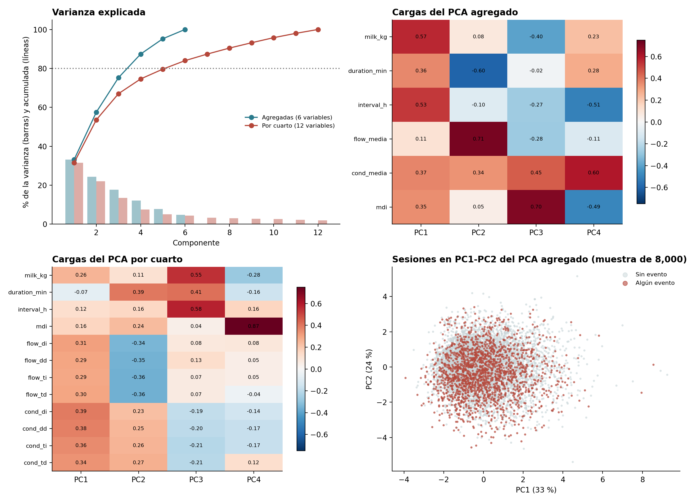

| | PCA agregado (6 variables) | PCA por cuarto (12 variables) |
|---|---|---|
| Varianza explicada por PC1, PC2, PC3, PC4 | 33.4 %, 24.4 %, 17.6 %, 11.8 % | 31.6 %, 22.1 %, 13.3 %, 7.6 % |
| Componentes para el 80 % de la varianza | 4 (de 6) | 6 (de 12) |
| Componentes con valor propio mayor a 1 | 3 | 3 |

**Lectura de los componentes (PCA agregado).** PC1 (33 %) es «ordeño grande y espaciado»: producción (0.56), intervalo (0.53), conductividad (0.37) y duración (0.37). PC2 (24 %) es la velocidad de ordeño: flujo (0.71) contra duración (−0.59). PC3 (18 %) es el MDI (0.71) con la conductividad (0.43). En el PCA por cuarto, PC1 agrupa la conductividad de los cuatro cuartos (0.34 a 0.39) junto con el flujo, y PC4 es casi solo el MDI (0.88).

**¿Hay algo rescatable?** Se comparan los puntajes entre sesiones con y sin evento con la diferencia de medias, su IC 95 % (t de Welch) y la d de Cohen (diferencia entre la desviación estándar combinada; 0.2 pequeño, 0.5 mediano, 0.8 grande):

| Evento | PC1 | PC2 | PC3 |
|---|---:|---:|---:|
| Patada | 0.09 | −0.16 | 0.00 |
| Ordeño incompleto | −0.13 | **−0.61** | **0.51** |
| Pezón no encontrado | −0.10 | **−0.66** | 0.26 |

(d de Cohen, PCA agregado). Sí hay algo: **PC2 (velocidad de ordeño) separa con efecto mediano** los ordeños incompletos y los de pezón no encontrado, que son más lentos y largos; PC3 (MDI y conductividad) separa los incompletos (d = 0.51). **La patada no se separa en ningún componente** (|d| ≤ 0.16), lo que confirma que es otro fenómeno. En el PCA por cuarto la separación de pezón no encontrado en PC1 llega a d = −1.07, pero ese número es engañoso: exigir los cuatro cuartos con leche deja solo 1.5 % de pezones no encontrados (contra 11.8 % en todos los datos), de modo que el subconjunto está sesgado.

Dos advertencias: (1) las variables del PCA se miden durante la misma sesión que el evento, así que son más bien consecuencias que predictores de una alerta temprana; (2) 6 componentes de 12 para llegar al 80 % indican que las variables por cuarto aportan información propia, y no conviene reducirlas a pocos componentes sin perder detalle. En resumen: el PCA **describe** bien el ordeño lento o incompleto, pero no aporta una señal temprana ni separa las patadas.

### 3.10 Naturaleza de los datos, multicolinealidad y escalas

- **Naturaleza de los datos:** las correlaciones lineales con los eventos son débiles (R² de 0.01 para patadas y hasta 0.11 para incompleto o pezón no encontrado, y solo con variables de la misma sesión) y los eventos se traslapan con los demás en el diagrama de pares. Se espera, como en otros problemas con variables débiles, que un modelo lineal explique poco y que haga falta capturar relaciones no lineales y el historial de la vaca.
- **Multicolinealidad:** los VIF son menores a 3; los cuartos se parecen entre sí, pero no son redundantes.
- **Escalas:** las variables están en unidades muy distintas (kg, min, h, mS/cm, índices sin unidad). Se estandarizan con z-score para el PCA, y no es necesario para modelos de árboles.

## 4. Datos del clima integrados

Se unió cada sesión con la hora de clima de **NASA POWER** (cobertura del 100 %; ver [Investigacion_Clima.md](Investigacion_Clima.md)). La serie se usa tal como la entrega `descargar_clima.py`, sin corregir el desfase de +1 h que se detectó al compararla con una estación (sección 7). Se calculó el índice temperatura-humedad `THI = (1.8 T + 32) − (0.55 − 0.0055 · HR) · (1.8 T − 26)`. En el periodo, el 20.8 % de las sesiones ocurre con THI ≥ 68 y hay 710 de 1,296 días con THI máximo ≥ 70 (con ERA5-Land eran 22.9 % y 724 de 1,305).

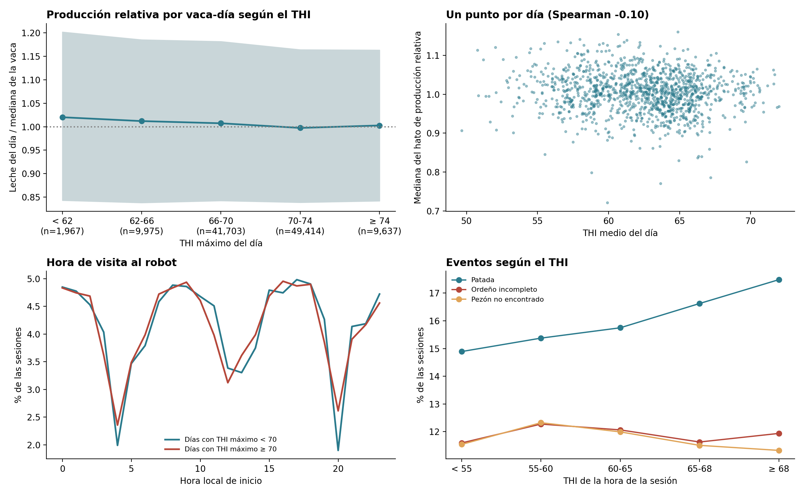

Para quitar las diferencias entre vacas y etapas de lactancia, la producción de cada vaca-día se divide entre la mediana de sus 28 registros anteriores («producción relativa»).

**El clima diario tiene al menos tres dimensiones.** Se ajustó un PCA a trece resúmenes diarios sobre 1,296 días con 24 horas completas. Nueve son de temperatura, humedad y THI (temperatura media, máxima y mínima; humedad; THI medio, máximo y mínimo; horas con THI alto; amplitud térmica). Los otros cuatro son variables que ERA5-Land no traía: viento, radiación solar, lluvia y nubosidad. Dos componentes explican el 78.7 % y hacen falta **tres para el 80 %** (86.6 %):

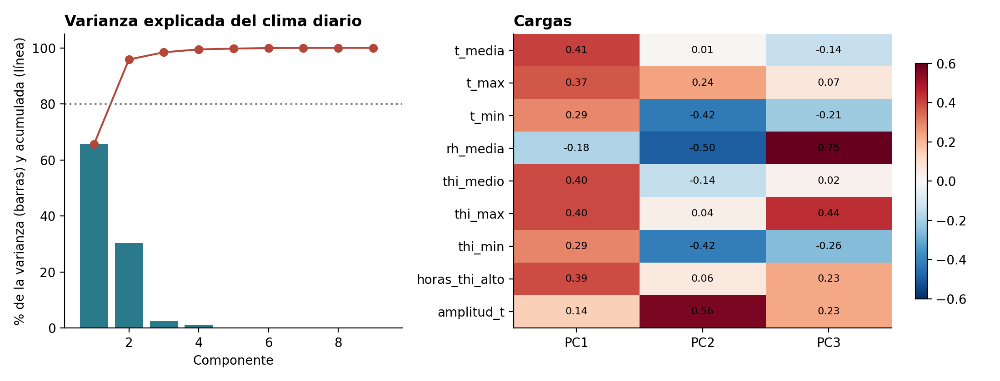

- **PC1 (51.1 %)** es el nivel térmico: temperatura media (0.38), THI máximo (0.38), horas con THI alto (0.37) y temperatura máxima (0.37); la radiación también carga aquí (0.29).
- **PC2 (27.6 %)** contrasta los días despejados y secos con los nublados y húmedos: amplitud térmica (0.47) contra nubosidad (−0.43), humedad (−0.37), temperatura mínima (−0.36) y lluvia (−0.33).
- **PC3 (7.9 %)** es casi solo el **viento** (0.97), que no se parece a ninguna otra variable.

Un solo índice (THI medio o máximo) captura el nivel, pero no la nubosidad ni el viento. Un modelo que quiera las tres señales necesita al menos tres variables de clima: nivel térmico, amplitud o nubosidad, y viento.

## 5. Hipótesis iniciales

| # | Hipótesis | Evidencia exploratoria | Estado |
|---|---|---|---|
| H1 | Con THI alto baja la producción por vaca | En días con THI máximo ≥ 68, ≥ 70 y ≥ 72 la producción relativa del hato es **1.0 a 1.1 puntos porcentuales menor** que en días más frescos (IC 95 %, por ejemplo −1.6 a −0.3 con 68; p de 0.0003 a 0.003). La mediana por grupo de THI máximo es casi plana (0.996 a 1.015). A nivel de hato, la correlación con el THI medio es débil y negativa: Spearman de −0.11 a −0.14 con rezagos de 0 a 5 días (p < 0.001) | **Débil pero detectable** (≈ −1 %, unos 0.4 kg por vaca-día), igual que con ERA5-Land. Los días no son independientes ni están libres de estacionalidad y el THI es de exterior y de una celda de ≈ 55 × 65 km |
| H2 | El calor cambia la frecuencia o la hora de las visitas | La diferencia en el % de sesiones entre 00 y 05 h entre días calurosos y frescos es −0.1 puntos con THI máximo ≥ 68 y +0.2 con ≥ 70 (IC con 0), y **+0.5 puntos** (IC 0.1 a 0.9, p = 0.013) con ≥ 72. El reparto por hora es casi idéntico: 23.6 % frente a 23.8 % entre 00 y 05 h y 25.0 % frente a 25.2 % entre 12 y 17 h | **No sustentada** salvo un efecto mínimo con el umbral de 72 |
| H3 | La proporción de eventos depende del robot y del cuarto | Diferencias pequeñas entre robots (V de Cramér ≤ 0.025); `97a5ee28` tiene más patadas (17.3 % ± 0.25 contra 15.8 % y 15.2 %). Los cuartos traseros tienen 3 veces más sesiones sin leche, y un cuarto en 0 kg acompaña al 71 % de los incompletos y al 87 % de los pezones no encontrados | **Parcial:** efecto del robot mínimo; el del cuarto es real |
| H4 | Las patadas se concentran en pocas vacas | El 10 % de las vacas aporta el 38 % de las patadas; 12 vacas patean en más del 40 % de sus sesiones | **Sustentada** |
| H5 | La conductividad alta antecede a las anomalías | La tasa de incompletos tiene forma de U según el decil de conductividad: 21.2 % en el decil más bajo, 9.6 % a 10 % en el centro y 12.3 % en el más alto. El extremo bajo es más fuerte que el alto. La conductividad domina PC1 del PCA por cuarto, pero ese subconjunto está sesgado (sección 3.9) | **Parcial.** Cuidado: la conductividad se mide en la misma sesión, por lo que puede ser consecuencia del incompleto y no un predictor |
| H6 | Los intervalos extremos se asocian a eventos | Incompletos: 28.2 % con intervalo menor a 4 h, 10.9 % a 12.5 % entre 4 y 16 h, 15.9 % entre 16 y 24 h y 15.4 % entre 24 y 48 h | **Sustentada.** El sentido causal no está claro: un intervalo corto puede ser un reintento tras un ordeño incompleto |
| H7 | La producción tiene estacionalidad anual y tendencia | Sin patrón anual claro en 3.5 años; la lactancia (pico al día 39) y el crecimiento del hato dominan. Además el incompleto y el pezón no encontrado suben de 2022 a 2025 | **No concluyente** |

**Hallazgos adicionales.**

- La **tasa de patadas sube con el THI de la hora de la sesión**, de 15.3 % con THI menor a 55 a 17.6 % con THI de 68 o más (+2.3 puntos porcentuales; +2.6 con ERA5-Land). Está confundida con la hora del día (las patadas son más frecuentes a mediodía y tarde, 16.3 % a 17.6 % entre 10 y 20 h frente a 14.6 % a 15.7 % de madrugada); se debe controlar antes de afirmarlo. Los ordeños incompletos y los pezones no encontrados no muestran relación con el THI.
- Los eventos **se agrupan en el tiempo**: tras una sesión con evento la probabilidad del siguiente es de 3.3 a 4.5 veces mayor, y 1.5 a 1.6 veces mayor que lo esperable solo por la vaca (sección 3.7).
- Las vacas recién ingresadas muestran más eventos entre la semana 1 y el mes 1 (sección 3.8), confundido con el inicio de la lactancia.

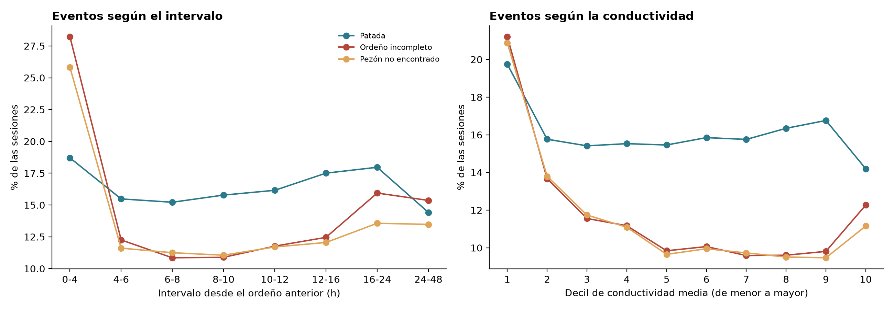

## 6. Implicaciones para el modelado

1. **Definir las etiquetas con cuidado.** `incomplete` y `teat_missing` están casi fusionados; conviene decidir si son una o dos clases y excluir la información de una al predecir la otra.
2. **Variables medidas en la misma sesión** (conductividad, duración, producción, flujo, cuartos con 0 kg) pueden ser consecuencia del evento; para una alerta temprana hay que usar solo lo disponible antes del evento (intervalo previo, historial de la vaca, clima).
3. **Aprovechar el historial de la vaca.** La persistencia es la señal más clara que se encontró (hasta 4.5 veces la tasa base y 1.5 veces lo esperable por la vaca); las variables rezagadas por vaca son buenas candidatas.
4. **Validar por vaca y por tiempo**, no por sesión al azar: la identidad de la vaca explica gran parte de los eventos, y el incompleto y el pezón no encontrado cambian de nivel con los años.
5. **Tratar los ceros de conductividad y flujo como faltantes**, y considerar la avería del sensor TD en el robot `74bb9015`. Tratar también como faltantes los intervalos de más de 48 h, que son regresos tras una brecha.
6. **Clima:** el efecto aparente sobre producción y visitas es pequeño (≈ −1 % de producción). Conviene probarlo como variable de contexto (THI máximo del día, horas acumuladas y rezagos), sin esperar que sea la señal principal, y con al menos tres variables (nivel térmico, nubosidad o amplitud, y viento).
7. **No imputar los cuartos sin leche:** esa leche no existió y su ausencia acompaña a los eventos; el modelo debe saber cuántos cuartos ordeña cada vaca.

## 7. Limitaciones y pendientes

- El consumo de concentrado, los historiales y los reportes del 18/07/2025 no forman parte del dataset anonimizado y quedaron fuera de esta versión.
- No hay fecha de parto ni etiquetas de salud: la lactancia se aproxima por brechas de registro, sin validación contra una fecha de parto.
- El clima es de exterior y de una celda de NASA POWER de ½° × ⅝° (≈ 55 × 65 km); no mide el microclima del establo. Contra una estación observada, su THI diario tiene más error que el de ERA5-Land (RMSE 1.72 contra 1.29), y sus horas quedan **desfasadas una hora**: la correlación por hora con la estación sube de 0.884 a 0.943 al correr la serie una hora hacia adelante. Aquí se usa sin corregir, como la entrega `descargar_clima.py`, así que el clima asignado a cada sesión puede ser el de la hora contigua; afecta el análisis por hora (patadas según el THI), no los resúmenes diarios.
- Los hashes de vaca y de robot dependen de la llave de `anonymize_data.py`: si se regenera el dataset con otra llave, cambian (no los resultados).
- Los intervalos de confianza de las tasas suponen sesiones independientes y son optimistas; el análisis de H1 y H2 usa un dato por día, pero los días tampoco son independientes (estacionalidad).
- Falta confirmar con el socio formador la interpretación de los huecos de las 04, 12–13 y 20 h, el sensor TD del robot `74bb9015` (traducirlo con el mapa de equivalencias), la definición exacta de `incomplete`, `teat_missing` y `kick`, si el robot reintenta tras un incompleto, y la fecha de parto y secado por vaca.
- Falta decidir si el modelo se despliega con pronóstico o con clima observado.

## 8. Cómo reproducirlo

```bash
python src/DU/generate_data.py          # une los archivos de Data/vacas/ en Data/dataset_vacas.csv
python src/DU/anonymize_data.py         # aplica el hash a vaca y robot (llave COWSKEY)
python src/DU/descargar_clima.py        # clima por hora de NASA POWER (usa red)
python src/DU/exploracion_datos.py      # figuras e indicadores de la primera exploración
python src/DU/exploracion_profunda.py   # profundización y PCA
```

Los scripts de exploración leen `Data/dataset_vacas_anonimo.csv` (`--datos`) y `Data/clima/clima_nasa_power_por_hora.csv` (`--clima`), escriben las figuras en `docs/DU/figuras/` y guardan los datos intermedios (clima, indicadores en JSON, tablas de correlación y diccionario) en `Data/`, fuera del control de versiones. Requieren `numpy`, `pandas`, `matplotlib`, `seaborn`, `scipy`, `scikit-learn`, `statsmodels` y `requests`.

## Anexo: marco estadístico

Cada técnica se describe con tres partes: qué mide (y su fórmula), cómo se lee y su advertencia.

| Técnica | Qué mide y fórmula | Cómo se lee | Advertencia |
|---|---|---|---|
| Media contra mediana | Media `x̄ = Σx/n`; mediana, valor central | Si la media se aleja de la mediana, hay valores extremos que la jalan | Con colas largas el valor típico es la mediana |
| Desviación estándar contra IQR | `s = √(Σ(x − x̄)²/(n − 1))`; `IQR = Q3 − Q1` | La desviación penaliza más los valores extremos; el IQR es robusto | La desviación estándar se infla con atípicos |
| Atípicos por IQR | Atípico si `x < Q1 − 1.5 IQR` o `x > Q3 + 1.5 IQR` | Marca los valores que merecen revisión | Marcar no es eliminar: aquí los extremos pueden ser eventos |
| Logaritmo | `ln(x)` comprime la cola derecha | Si media y mediana se igualan, la forma es más simétrica | Puede sobrecorregir; no existe para valores ≤ 0 |
| Covarianza y correlación | `cov(X,Y) = Σ(x − x̄)(y − ȳ)/(n − 1)`; `r = cov/(s_x s_y)`; `R² = r²` | `r` va de −1 a 1 y no depende de las unidades; `R²` es la parte de la variación que explica la relación lineal | Solo mide relación lineal; con eventos 0/1 es la correlación punto-biserial |
| Significancia de la correlación | `t = r√(n − 2)/√(1 − r²)` con `n − 2` grados de libertad, prueba bilateral | Un p-value pequeño dice que `r` probablemente no es 0 | Con 280 mil filas todo es significativo; importa el tamaño de `r`, no el p-value |
| IC 95 % de una proporción | `p̂ ± 1.96 √(p̂(1 − p̂)/n)` | Rango donde cae la tasa verdadera con 95 % de confianza | Supone observaciones independientes; las sesiones de una vaca no lo son |
| t de Welch (diferencia de medias) | `t = (x̄₁ − x̄₂)/√(s₁²/n₁ + s₂²/n₂)`; IC: diferencia ± 1.96 · EE | Si el IC no incluye 0, la diferencia no es compatible con 0 | Los días y las vacas no son independientes; el IC es optimista |
| VIF | `VIF_j = 1/(1 − R²_j)`, con `R²_j` de explicar la variable `j` con las demás | Más de 5 indica redundancia | Un VIF bajo no descarta relaciones no lineales |
| Persistencia | `P(evento\|previo con evento)` frente a `P(evento\|previo sin evento)` y a lo esperado por la vaca (promedio de su tasa propia, ponderado por las sesiones que siguen a un evento) | Una razón mayor a 1 sobre lo esperado indica agrupamiento más allá de la vaca | Puede incluir reintentos del robot |
| PCA | Se estandariza `z = (x − x̄)/s`; los componentes son los vectores propios de la matriz de correlación; varianza explicada de PC_k = `λ_k/Σλ` | Las cargas muestran qué variables forman cada componente | Solo ve relaciones lineales y no usa la etiqueta |
| d de Cohen | `d = (x̄₁ − x̄₂)/s_combinada` | 0.2 pequeño, 0.5 mediano, 0.8 grande | Depende de la muestra y del subconjunto usado |
| Spearman | Correlación de los rangos | Robusta a atípicos y a relaciones no lineales monótonas | No distingue el sentido causal |
| V de Cramér y chi-cuadrada | Asociación entre dos variables categóricas | V de 0 a 1; < 0.1 es efecto mínimo | Con muchos datos la chi-cuadrada siempre es significativa |
