# **Reporte: Entendimiento de los datos**
**Por PINU**

Fase *Data Understanding* (CRISP-DM). Este reporte resume lo que se encontró en el análisis exploratorio del equipo y deja constancia de cómo cumple con cada tarea de la fase. Todas las cifras salen del notebook [`final_data_understanding.ipynb`](../../src/DU/final_data_understanding.ipynb), que fusiona los EDA de cada integrante; las figuras se extrajeron de ese mismo notebook y están en [`figuras/`](figuras/) con el prefijo `nb_`.

**[Resumen](#resumen)**

**[1. Datos y método](#1-datos-y-método)**

**[2. Formato y tipos de datos](#2-formato-y-tipos-de-datos)**

**[3. Características del dataset](#3-características-del-dataset)**

**[4. Visualizar y consultar los datos](#4-visualizar-y-consultar-los-datos)**

**[5. Patrones y distribuciones](#5-patrones-y-distribuciones)**

**[6. Datos del clima integrados](#6-datos-del-clima-integrados)**

**[7. Hipótesis iniciales](#7-hipótesis-iniciales)**

**[8. Reporte de calidad de los datos](#8-reporte-de-calidad-de-los-datos)**

**[9. Datos atípicos](#9-datos-atípicos)**

**[10. Contraste con los requerimientos del proyecto](#10-contraste-con-los-requerimientos-del-proyecto)**

**[11. Implicaciones para la preparación y el modelado](#11-implicaciones-para-la-preparación-y-el-modelado)**

**[12. Limitaciones y pendientes](#12-limitaciones-y-pendientes)**

**[13. Adaptaciones de la metodología CRISP-DM](#13-adaptaciones-de-la-metodología-crisp-dm)**

> Los resultados son exploratorios: describen asociaciones y no demuestran causas. Las vacas y las máquinas se muestran con el hash de `anonymize_data.py`.

# **Resumen**

- **Los datos sirven para el objetivo, con tratamientos claros.** Hay 280,697 ordeños de 207 vacas en tres robots, del 13/07/2022 al 28/01/2026, con identificador de vaca en el 100 % de las filas, variables del proceso de ordeño y clima de NASA POWER para el 100 % de las sesiones. Requieren limpieza (dos formatos de fecha, sesiones repetidas entre fuentes, ceros de conductividad que en realidad son faltantes y columnas vacías), pero no hay un problema que impida modelar.
- **Los eventos son el 12 al 16 % de los ordeños.** Un modelo que siempre responda «sin evento» ya tiene 84 a 88 % de exactitud (*accuracy*) para cada evento por separado, así que el criterio de éxito de 80 % de accuracy no es informativo por sí solo para esos eventos y debe acompañarse de precisión, sensibilidad o F1 (sección 10).
- **Lo que más informa sobre un evento no es el clima.** El clima casi no se relaciona con el ordeño (|r| ≤ 0.03 con los eventos). Pesan más el historial de la vaca (un evento previo multiplica entre 3.3 y 4.5 veces la probabilidad del siguiente), el intervalo desde el ordeño anterior y el estado de los cuartos.
- **Hay señales de un problema de cola, pero no se puede medir directamente.** La ocupación de las máquinas pasó de 13 % a 71 % entre 2022 y 2026 y los relevos pegados de 21 % a 80 %, con las mismas tres máquinas y un hato que creció de 34 a 182 vacas. El dataset no registra la llegada a la fila, así que la espera es una estimación.
- **Pendientes con el socio formador:** definir las clases de evento, confirmar las pausas fijas de las 4, 12 y 20 h, el sensor de conductividad del cuarto trasero derecho y la unidad del concentrado.

# **1. Datos y método**

| Elemento | Detalle |
| :---- | :---- |
| Ordeño | `Data/dataset_vacas_anonimo.csv`, que une los reportes csv (marzo a julio de 2025) y los históricos xlsx de producción (2022 a 2026). Original: **286,217 filas y 44 columnas**. Cada fila es una visita de una vaca a una máquina de ordeño. |
| Clima | `Data/clima/clima_nasa_power_por_hora.csv`: NASA POWER, serie horaria en hora local, 13 variables (ver [Investigacion_Clima.md](Investigacion_Clima.md)). |
| Concentrado | `Data/dataset_concentrado_anonimo.csv` (`vacas/4.0`): registros de concentrado consumido por vaca, anonimizados con el mismo mapa que el ordeño, del 28/01/2025 al 28/01/2026. Se une al ordeño por `id_vaca`. |
| Código | [`src/DU/final_data_understanding.ipynb`](../../src/DU/final_data_understanding.ipynb) (fusión de los EDA individuales, en `src/DU/IndividualEda/`). |
| Datos | Fuera del repositorio (`Data/`), según la política de uso de datos. |

**Tras la limpieza.** De las 286,217 filas originales quedan 280,915 (se quitan 2 duplicados exactos y las sesiones del csv que ya venían en el xlsx). De ellas, 280,697 son ordeños de las tres máquinas, y son la base del análisis; las otras son 216 visitas rechazadas o de «echada sin ordeñar» (solo se registran en 2025) y 2 sesiones de un cuarto valor de máquina.

# **2. Formato y tipos de datos**

El archivo original tiene **30 columnas numéricas (`float64`) y 14 de texto**. Pandas asigna un tipo distinto al real en varias de ellas:

| Columna | Tipo al cargar | Tipo real | Problema | Tratamiento |
| :---- | :---- | :---- | :---- | :---- |
| `main_hora_de_inicio` | texto | fecha-hora | Dos formatos: csv `01/03/2025 05:37 a. m.` y xlsx `2025-03-01 05:37:12` (el csv no trae segundos) | Se convierte a `datetime` (`inicio`) |
| `main_duracion_mm_ss` | texto | duración | `mm:ss` en el csv y `hh:mm:ss` en el xlsx | Se convierte a segundos (`duracion_seg`) |
| `main_intervalo_de_ordeno_hh_mm` | texto | duración | Los intervalos de 24 h o más están guardados como fecha de Excel (`1900-01-01 00:59:02` equivale a 24 h 59 min) | Se convierte a horas; los de más de 48 h son regresos tras una brecha y se tratan como faltantes |
| `estado_patada`, `estado_incompleto`, `estado_pezones_no_encontrados`, `estado_amd_pezon` | texto | lista de cuartos | Guardan los cuartos afectados (`TI`, `DI,TD`, `Todos`), no un sí o no; el nulo significa «no ocurrió» | Banderas 0/1 por cuarto |
| `estado_numero_de_ordeno`, `estado_amd_ubre` | `float` | entero / 0-1 | Son `float` solo porque tienen nulos | Sin cambio |
| `id_vaca`, `misc_eo_po` | texto | identificador | Son hashes, no cantidades | Se leen como texto |
| `main_accion` | texto | categoría | Solo la traen los csv (2.5 % de las filas); los xlsx solo tienen ordeños | Los xlsx se toman como «Ordeño» |

Después de la limpieza el notebook deja las fechas como `datetime64`, la duración y el intervalo como números, las alertas por cuarto como 0/1 (multi-hot) y las categorías de una sola etiqueta con codificación one-hot (sección 20 del notebook).

# **3. Características del dataset**

| Característica | Valor |
| :---- | :---- |
| Unidad de observación | Una visita de una vaca a una máquina de ordeño |
| Ordeños analizados | 280,697 |
| Vacas | 207 (sesiones por vaca: mediana 1,264, mínimo 2, máximo 3,569; tres vacas con menos de 30) |
| Periodo | 13/07/2022 a 28/01/2026 |
| Máquinas | 3 con carga parecida (de 91 a 98 mil ordeños cada una) y un cuarto valor con 2 registros |
| Hato | Crece de 34 vacas activas por mes (julio de 2022) a 182 (enero de 2026) con las mismas máquinas |
| Destino de la leche | Tanque 94 %; el resto Drenaje (≈ 10,400 ordeños) y Divert 3 (≈ 5,400) |

**Grupos de columnas.**

| Grupo | Columnas | Contenido |
| :---- | :---- | :---- |
| Identificación y resumen (`main_*`) | `id_vaca`, `main_hora_de_inicio`, `main_accion`, `main_duracion_mm_ss`, `main_produccion_kg`, `main_intervalo_de_ordeno_hh_mm` | Quién, cuándo, cuánto dura y cuánto produce la sesión |
| Estado (`estado_*`) | número de ordeño del día, patada, incompleto, pezones no encontrados, AMD de pezón y de ubre, MDI | Eventos del ordeño e índice de mastitis del robot |
| Mediciones por cuarto (DI, DD, TI, TD) | producción, flujo medio y máximo, sangre, conductividad | 21 columnas de medición continua (la producción total más cinco magnitudes por cuatro cuartos) |
| Contexto (`misc_*`) | máquina, destino de la leche, razón de la desviación, usuario, programa de lavado | Dónde y a dónde va la leche |
| Contadores | `contadores_monitorizacion_vaca_*` | Solo existen en el xlsx; su significado debe confirmarse con el cliente |

Los sufijos `_di`, `_dd`, `_ti` y `_td` indican el cuarto de la ubre: delantero izquierdo, delantero derecho, trasero izquierdo y trasero derecho.

**Estadísticos principales** (ordeños, n = 280,697):

| Variable | Mediana | Media | Rango intercuartil | Máximo |
| :---- | ---: | ---: | :---- | ---: |
| Producción por ordeño (kg) | 14.29 | 14.82 | 11.07 a 18.10 | 78.17 |
| Duración (min) | 7.60 | 8.10 | 6.25 a 9.40 | 55.80 |
| Intervalo desde el ordeño anterior (h) | 9.21 | 9.92 | 7.41 a 11.64 | 47.92 (más de 48 h = faltante) |
| Flujo medio (kg/min) | 1.18 | 1.19 | 0.96 a 1.40 | 4.62 |
| Conductividad media (mS/cm, sin ceros) | 4.93 | 4.95 | 4.64 a 5.23 | 11.22 |
| MDI | 1.10 | 1.23 | 1.06 a 1.18 | 15.36 |

**Observaciones.** El historial por vaca es muy desigual y no existe la hora de salida, solo la de inicio y la duración. `sangre_ppm_*` es casi siempre 0, con máximos de 8,000 ppm. La conductividad tiene mínimo 0, lo cual es imposible en leche (sección 8). El dataset no trae fecha de parto, etiquetas de salud ni la hora de llegada a la fila.

# **4. Visualizar y consultar los datos**

Consultas de ejemplo sobre los datos ya unificados:

| Consulta | Resultado |
| :---- | :---- |
| ¿Qué tipos de visita hay y en qué máquina? | El 99.9 % son ordeños; las 216 visitas rechazadas o de echada sin ordeñar son de 2025 (2.4 % y 0.8 % de las visitas del csv). |
| ¿Cuántos registros tiene cada vaca? | Mediana de 1,264 (rango de 2 a 3,569). |
| Mediana de duración con y sin evento | El incompleto y el pezón no encontrado alargan el ordeño unos 2 min (9.5 y 9.9 min contra 7.4). |
| ¿Cuántos ordeños tienen al menos un evento? | Uno de cada tres (32.6 %): patada 16.1 %, incompleto 11.9 %, pezón no encontrado 11.8 %, AMD de pezón 9.3 %. |
| ¿Dónde se quedan sin leche los cuartos? | En 10.2 % de los ordeños al menos un cuarto da 0 kg; los traseros concentran el 75 % de esos casos. |

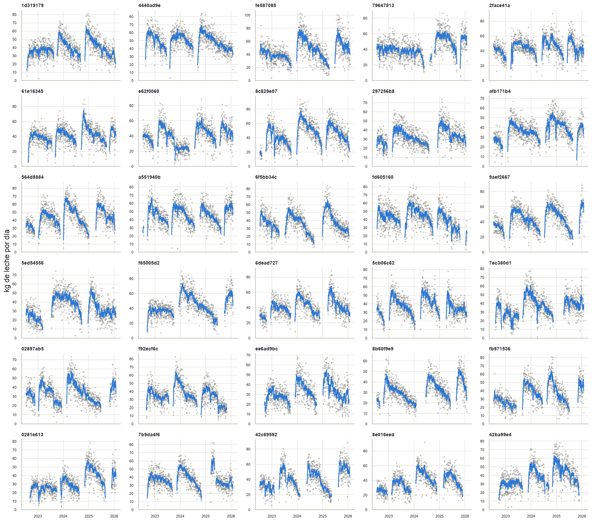

*Cada punto gris es la producción total de un día y la línea azul el promedio móvil de 7 días. Se ve la curva de lactancia: la producción sube tras el parto hasta un pico y baja poco a poco.*

# **5. Patrones y distribuciones**

## 5.1 Distribuciones

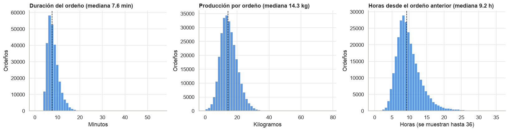

Las tres variables son asimétricas a la derecha. La mitad central de los ordeños dura entre 6.3 y 9.4 min, produce entre 11.1 y 18.1 kg y ocurre entre 7.4 y 11.7 h después del anterior. Las colas largas son poco frecuentes pero existen (ordeños de hasta 56 min, 164 ordeños con 0 kg), y en logaritmo las tres variables quedan casi simétricas, lo que justifica transformarlas o usar métodos robustos.

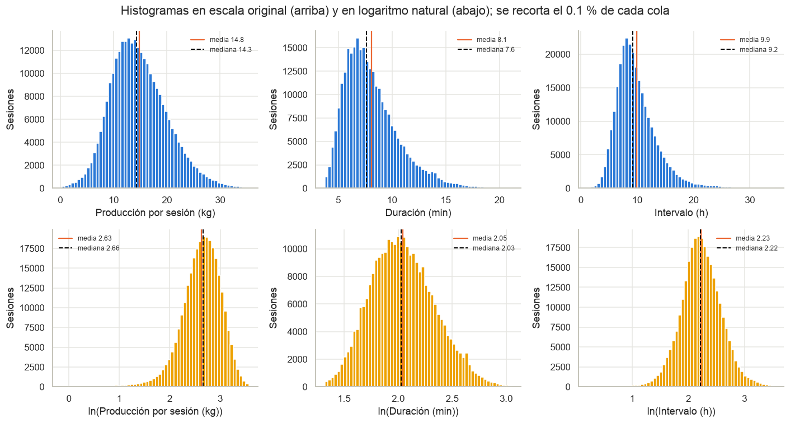

## 5.2 Patrones temporales

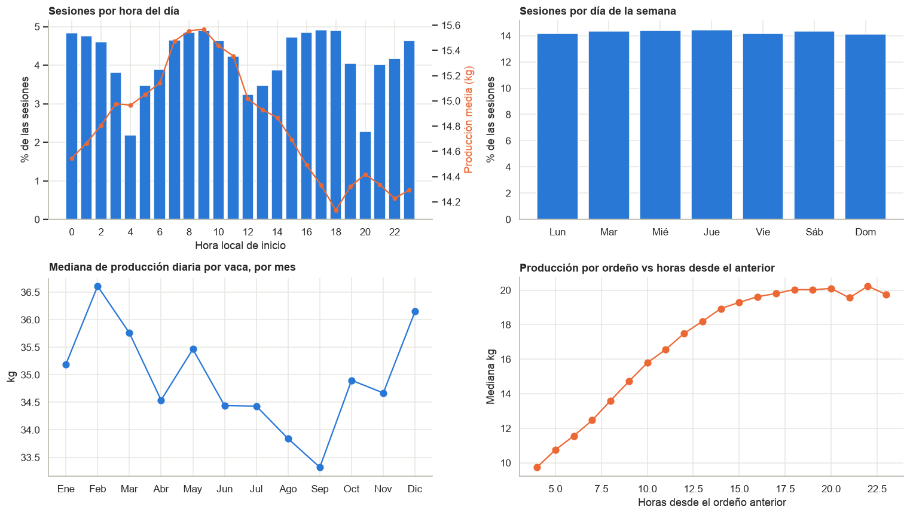

- **Hora del día:** hay tres caídas claras en el número de ordeños cerca de las 4, 12 y 20 h, que parecen pausas fijas de operación (limpieza o manejo del establo) y deben confirmarse con el CAETEC. La mayor producción media por ordeño ocurre a las 9 h.
- **Mes del año:** la mediana de producción por vaca-día va de 33.3 kg en septiembre a 36.6 kg en febrero (unos 10 % de diferencia), con mínimos en agosto y septiembre. Puede deberse al calor o a la etapa de lactancia del hato, que no se puede separar sin fecha de parto.
- **Intervalo:** el patrón más fuerte del dataset. La producción por ordeño crece casi en línea recta con las horas desde el ordeño anterior (de unos 10 a unos 19 kg entre 4 y 15 h) y se estabiliza después. Un ordeño «bajo» puede ser normal si el intervalo fue corto.
- **Producción por vaca ordeñada:** se mantiene entre 31.7 y 38.8 kg por día, así que el crecimiento de la producción total se explica por tener más vacas y no porque cada vaca produzca más.

## 5.3 Ciclo de lactancia y ausencias

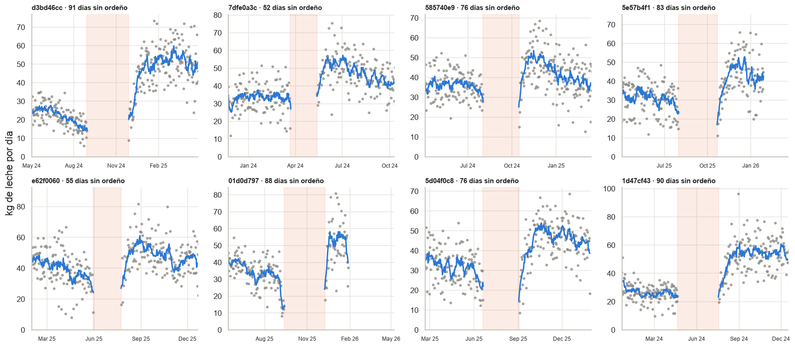

De las 237 ausencias de más de 40 días (de 129 vacas), la mediana dura 81 días, lo que coincide con un periodo de secado. Al volver, las vacas producen unos 24 kg al día, como antes de irse (25 kg), y llegan a un pico de unos 55 kg en una mediana de 45 días. Sin fecha de parto, la etapa de lactancia solo puede inferirse de estas curvas.

## 5.4 Cuartos y máquinas

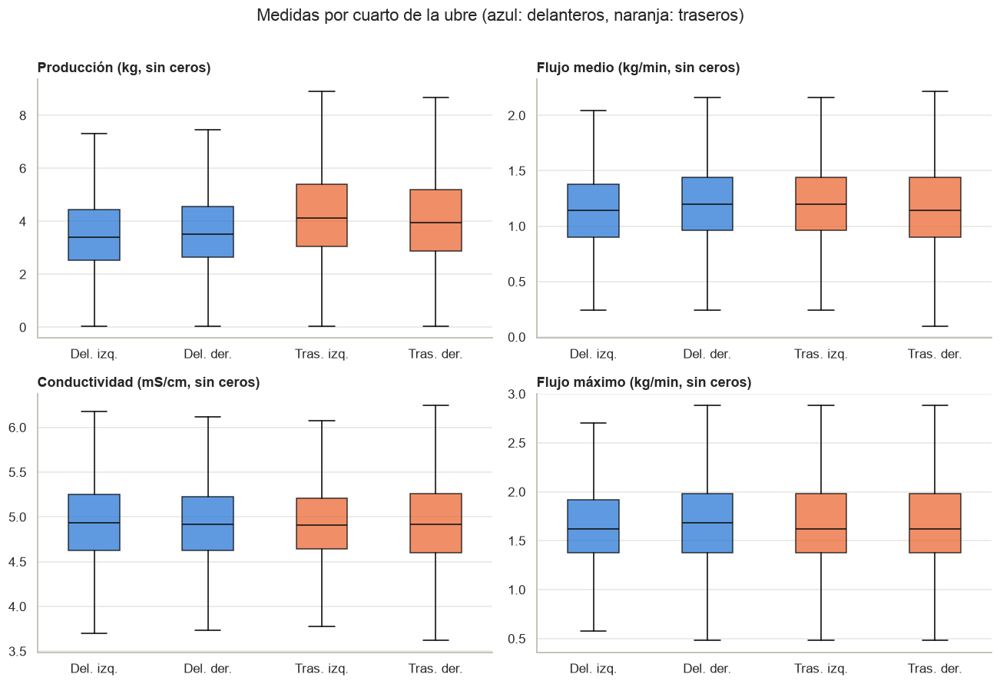

Los cuartos traseros producen más (mediana de 4.1 y 4.0 kg contra 3.4 y 3.5 kg de los delanteros) con flujo y conductividad casi iguales, por lo que producen más porque se ordeñan más tiempo y no porque fluya más leche. También se quedan sin leche más veces: 4.6 y 4.7 % de los ordeños contra 1.5 y 1.6 % de los delanteros.

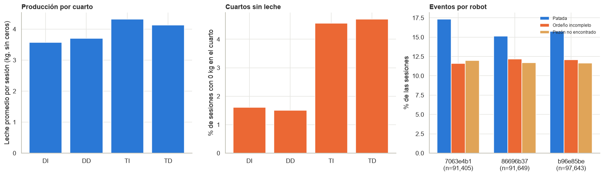

Entre máquinas la tasa de eventos es parecida (patada de 15.2 a 17.3 %, incompleto de 11.6 a 12.2 %, pezón no encontrado de 11.6 a 12.0 %). La prueba chi-cuadrada sale significativa para patada e incompleto solo por el tamaño de la muestra, con efecto despreciable (V de Cramér de 0.025 y 0.008); la máquina no explica los eventos. Los cuartos sin leche sí son informativos: 71.3 % de los ordeños incompletos y 86.7 % de los de pezón no encontrado tienen algún cuarto en 0 kg, contra 1.9 % y 0 % sin el evento.

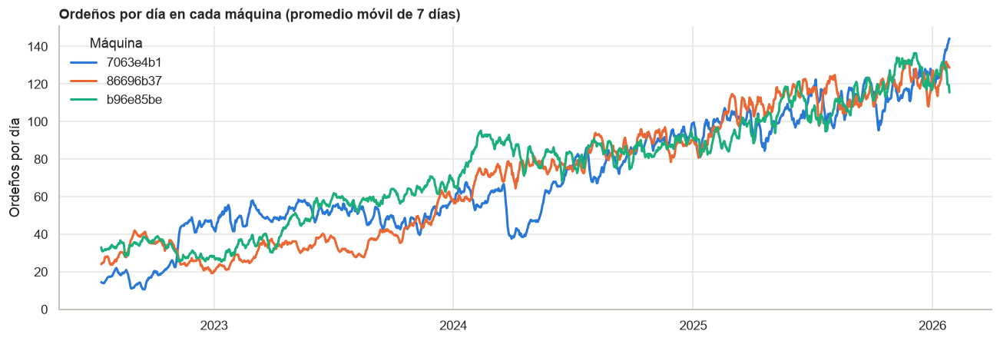

Las tres máquinas atienden una carga parecida y creciente: pasaron de 14 a 31 ordeños diarios en julio de 2022 a entre 120 y 141 en enero de 2026. La máquina `7063e4b1` cae a unos 38 ordeños diarios a finales de marzo de 2024, contra unos 63 a mediados de febrero, una baja que debe revisarse con el cliente (mantenimiento o falla).

## 5.5 Eventos

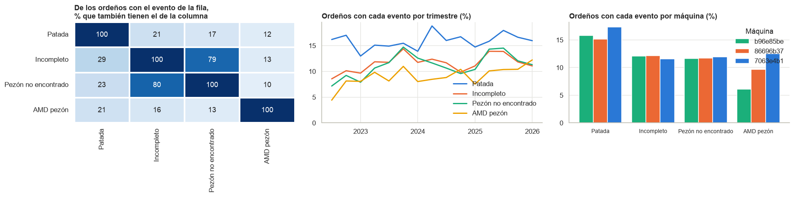

Uno de cada tres ordeños tiene al menos un evento. El incompleto y el pezón no encontrado son casi el mismo evento (79 y 80 % de coincidencia), afectan más a los cuartos traseros (5.0 a 5.6 % contra 1.9 a 2.5 % de los delanteros) y subieron desde 2022 (el incompleto de 9.4 % a 12.7 % en 2025). Cuarenta vacas tienen incompletos en más del 20 % de sus ordeños.

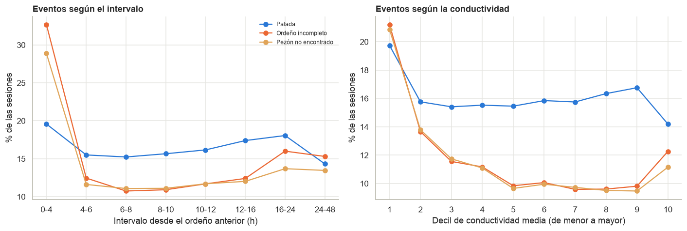

El incompleto se dispara cuando la vaca regresa antes de 4 h (32.7 % contra 10.7 a 12.5 % entre 4 y 12 h) y también en el decil más bajo de conductividad (21.2 %), lo que coincide con cuartos que casi no tienen leche.

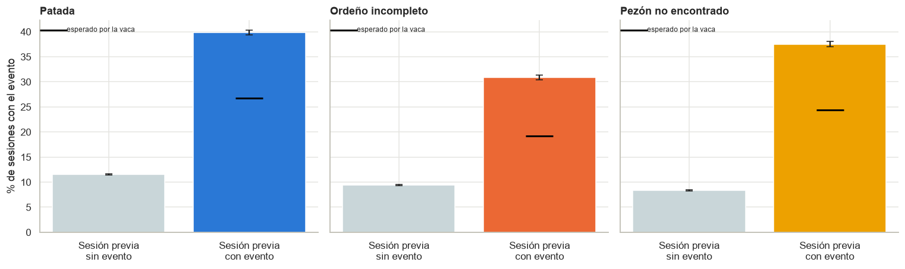

Los eventos se repiten: tras un evento en la sesión anterior (menos de 24 h) la probabilidad de volver a tenerlo es 39.9 % (patada), 30.9 % (incompleto) y 37.5 % (pezón), contra 11.5, 9.4 y 8.3 % sin evento previo, entre 1.5 y 1.6 veces lo que se esperaría solo por la tasa propia de la vaca. Además, el 10 % de las vacas con más eventos acumula 38.0 % de las patadas, 36.9 % de los pezones no encontrados y 30.8 % de los incompletos.

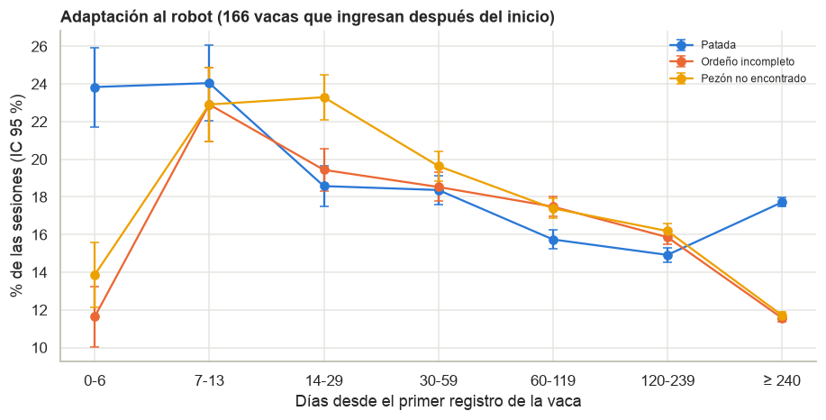

Las 166 vacas que ingresan después del inicio de los datos tienen más incompletos entre los días 7 y 29 (19 a 23 %) que después de 240 días (11.6 %), lo que sugiere una etapa de adaptación al robot confundida con el inicio de la lactancia.

## 5.6 Salud de la ubre

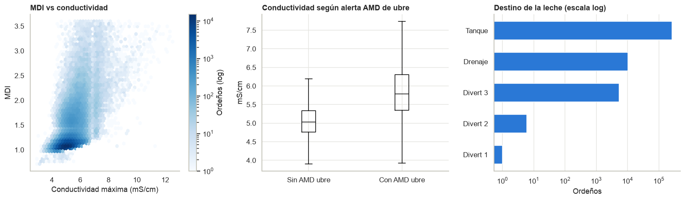

MDI y conductividad máxima se mueven juntos (Spearman 0.55) y las visitas con alerta AMD de ubre tienen conductividad más alta (mediana de 5.79 contra 5.03 mS/cm). Se aprecia una segunda nube con MDI cercano a 1.5 y conductividad de 5 a 7 mS/cm, separada de la zona normal (MDI de 1.0 a 1.1), que es el grupo a estudiar como posible anomalía.

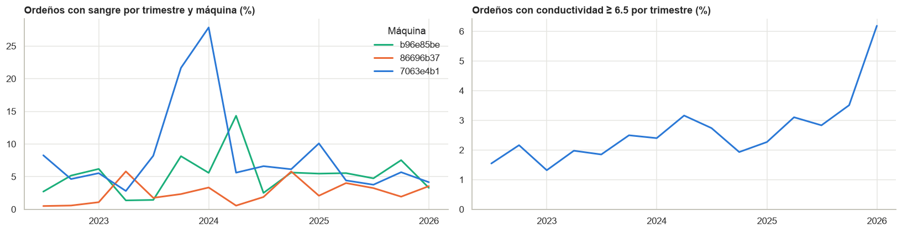

Aparece sangre en 5.5 % de los ordeños y en 204 de las 207 vacas, más en los cuartos delanteros (2.6 % en DI) que en los traseros (1.1 % en TD). La leche se desvía según la cantidad: con más de 1,000 ppm el 78.9 % va a `Divert 3`. La sangre tiene picos por máquina (hasta 27.8 % de los ordeños en `7063e4b1` en el primer trimestre de 2024) y las mismas vacas dan 8.4 %, 2.9 % y 6.4 % según la máquina, así que conviene revisar esos sensores con el cliente. Dentro de cada vaca, el 83 % produce menos en los ordeños con sangre detectada (diferencia mediana de −1.70 kg); es una asociación descriptiva, no un diagnóstico.

## 5.7 Correlaciones y redundancia

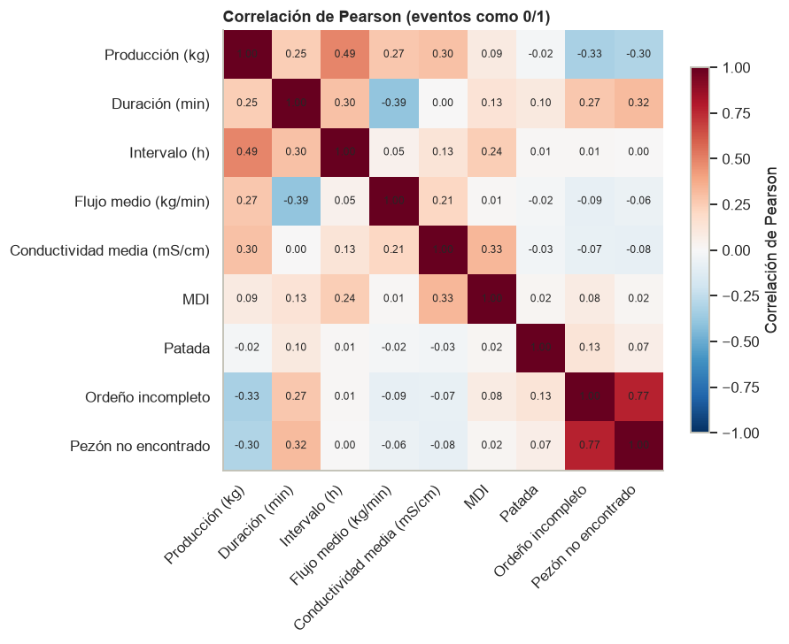

De 33 pares de variables, 31 son significativos (p < 0.001), pero con 280 mil ordeños eso es casi automático y importa el tamaño: las más fuertes son producción con intervalo (r = 0.49), duración con flujo medio (−0.39), conductividad con MDI (0.33) y producción con incompleto (−0.33). La patada casi no se correlaciona con nada (R² máximo 0.010). El factor de inflación de la varianza (VIF) es bajo en todos los casos (máximo 1.90 con las variables agregadas y 2.84 por cuarto), por lo que no hay multicolinealidad grave.

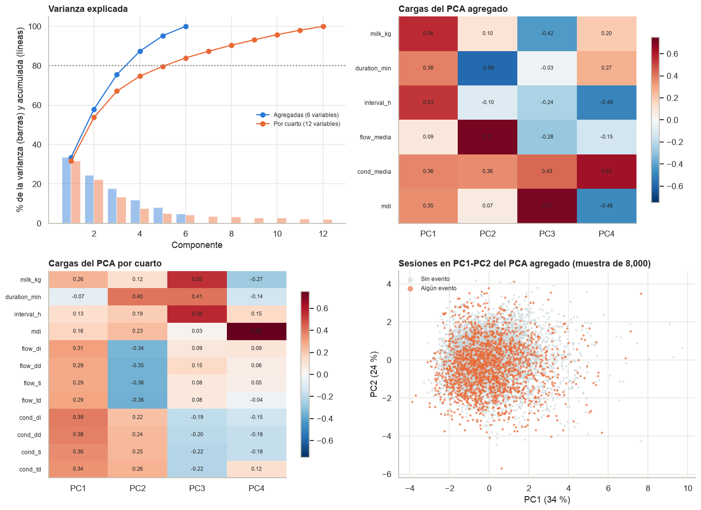

En el PCA de seis variables agregadas hacen falta 4 componentes para explicar el 80 % de la varianza (33.5, 24.4, 17.6 y 11.8 % los primeros cuatro): la información está repartida y no se reduce a un solo factor.

## 5.8 Cola

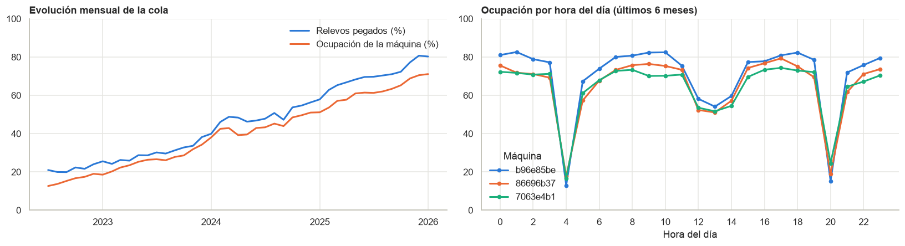

La cola no se puede medir directamente porque el dataset no registra la llegada de la vaca a la fila, solo el inicio y la duración del ordeño. La estimación indirecta es la siguiente:

| Indicador | Resultado |
| :---- | :---- |
| Relevos pegados (la siguiente vaca entra a 2 min o menos de que termine la anterior) | De 21 % en 2022 a 80 % en 2026 |
| Ocupación de las máquinas | De 13 % en 2022 a 71 % en 2026 |
| Carga actual por máquina (últimos 3 meses) | De 121.5 a 125.8 ordeños al día, 67 a 73 % de ocupación, hueco mediano de 0.5 a 0.6 min |
| Espera estimada (fórmula de Pollaczek-Khinchine, llegadas al azar) | De 8.8 a 12.9 min por vaca; la más alta en `b96e85be` |
| Holgura | Solo las pausas de las 4:00 y las 20:00 |

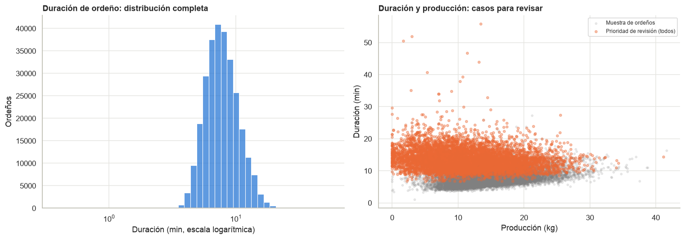

Por vaca, 14,046 ordeños superan el percentil 95 de duración de su propia vaca y 7,449 de ellos (53 %) además tienen producción o flujo bajos: son los candidatos a anomalía que ocupan la máquina sin producir. Las visitas posteriores a un intervalo mayor al percentil 95 tienen duración larga en 17.2 % de los casos contra 4.3 a 4.4 % en el resto.

# **6. Datos del clima integrados**

Se unió cada sesión con la hora de clima de NASA POWER (cobertura del 100 %). La fila etiquetada *t* de POWER describe el clima de *t* + 1 h, así que en la sección 17 del notebook la serie se corre una hora; la sección 7 del notebook usa el clima sin ese ajuste y llega a la misma conclusión general: el clima casi no se relaciona con el ordeño. Se calculó el índice temperatura-humedad `THI = (1.8 T + 32) − (0.55 − 0.0055 · HR) · (1.8 T − 26)`: en el periodo, el 21.8 % de las horas tiene THI ≥ 68 y el 21.2 % de las sesiones ocurre con THI ≥ 68.

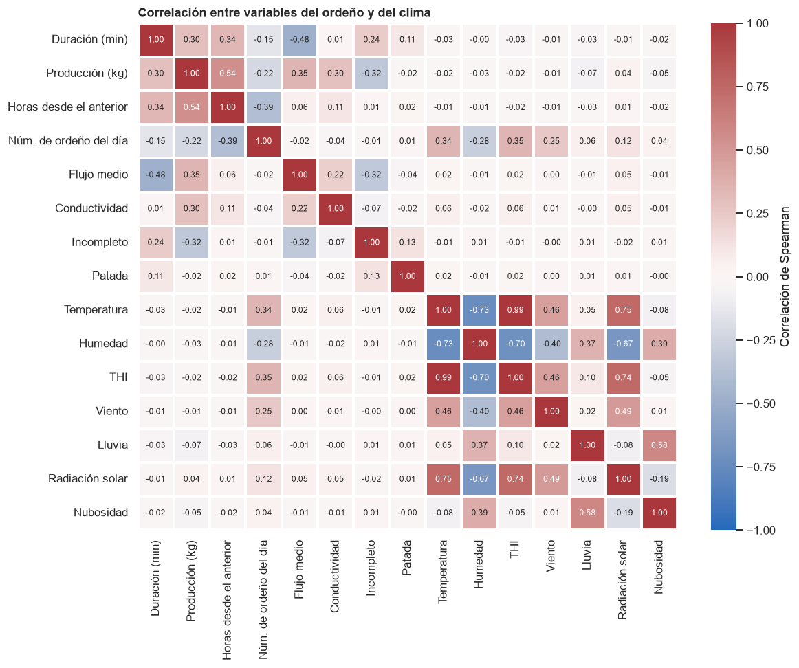

El clima casi no se relaciona con el ordeño: las correlaciones con la producción, la duración, el flujo, la conductividad y los eventos de patada o incompleto son de 0.07 o menos en valor absoluto. Como temperatura y THI son casi la misma variable (0.99), basta usar una.

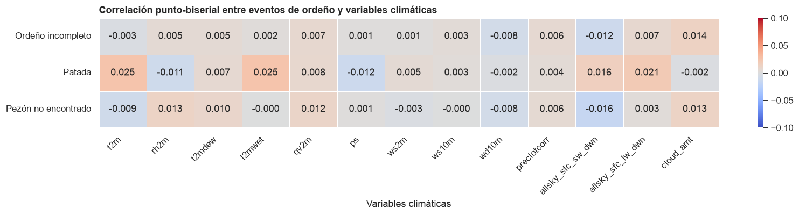

Las correlaciones de los tres eventos con las 13 variables climáticas son de 0.026 o menos en valor absoluto, y la mayor es la de patada con la temperatura de bulbo húmedo.

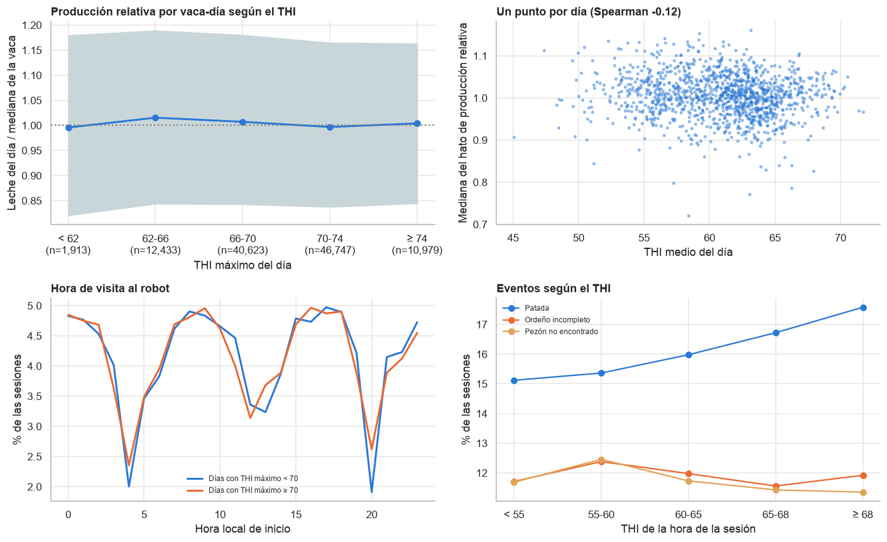

- La producción relativa de cada vaca (respecto a su propia mediana de 28 días) se queda alrededor de 1.0 en todos los rangos de THI (de 0.996 a 1.015).
- Aun así, en los días calurosos baja de 1.0 a 1.1 puntos porcentuales (p < 0.01 con los umbrales de THI máximo de 68, 70 y 72) y la correlación del hato con el THI medio es de −0.11 a −0.14 con rezagos de 0 a 5 días.
- La hora de visita casi no cambia en días calurosos (23.8 % contra 23.6 % de las sesiones entre 0 y 5 h).
- La patada sube con el THI de la hora (de 15.1 % con THI menor a 55 a 17.6 % con THI de 68 o más); el incompleto y el pezón no encontrado no cambian.

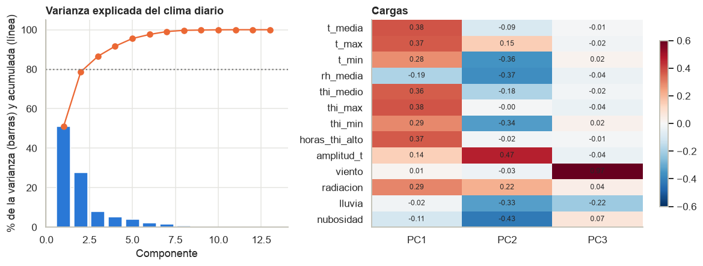

El clima diario tiene mucha redundancia: tres componentes explican 86.6 % de la varianza. El primero (51 %) es el nivel térmico (temperatura y THI), el segundo (27.6 %) contrasta días despejados con nublados y el tercero (7.9 %) es casi solo el viento. Un modelo necesita al menos estas tres señales: nivel térmico, nubosidad o amplitud, y viento.

# **7. Hipótesis iniciales**

| # | Hipótesis | Evidencia exploratoria | Estado |
| :---- | :---- | :---- | :---- |
| H1 | Con THI alto baja la producción por vaca | La producción relativa del hato es 1.0 a 1.1 puntos porcentuales menor en días con THI máximo ≥ 68, ≥ 70 y ≥ 72 (p de 0.0003 a 0.003); Spearman con el THI medio de −0.11 a −0.14 con rezagos de 0 a 5 días | **Débil pero detectable** (≈ −1 %) |
| H2 | El calor cambia la hora o la frecuencia de las visitas | Reparto por hora casi idéntico (23.8 % contra 23.6 % entre 0 y 5 h); solo +0.5 puntos con el umbral de 72 (p = 0.013) | **No sustentada** |
| H3 | La proporción de eventos depende de la máquina y del cuarto | Máquina: efecto despreciable (V de Cramér ≤ 0.025). Cuarto: los traseros tienen 3 veces más sesiones sin leche, y un cuarto en 0 kg acompaña al 71 % de los incompletos y al 87 % de los pezones no encontrados | **Parcial:** la máquina no, el cuarto sí |
| H4 | Los eventos se concentran en pocas vacas | El 10 % de las vacas acumula 38.0 % de las patadas, 36.9 % de los pezones y 30.8 % de los incompletos | **Sustentada** |
| H5 | La conductividad baja o alta antecede a las anomalías | Tasa de incompletos en forma de U por decil de conductividad: 21.2 % en el decil más bajo, cerca de 10 % en el centro y 12.3 % en el más alto | **Parcial.** La conductividad se mide en la misma sesión, por lo que puede ser consecuencia del evento y no un predictor |
| H6 | Los intervalos cortos se asocian a eventos | Incompletos: 32.7 % con intervalo menor a 4 h contra 10.7 a 12.5 % entre 4 y 12 h | **Sustentada.** El sentido causal no está claro: un intervalo corto puede ser un reintento tras un incompleto |
| H7 | La producción tiene estacionalidad anual | Variación de unos 10 % entre septiembre (33.3 kg) y febrero (36.6 kg) | **Parcial.** Confundida con la etapa de lactancia del hato |
| H8 | Un evento anticipa el siguiente de la misma vaca | Probabilidad de repetir 39.9, 30.9 y 37.5 % contra 11.5, 9.4 y 8.3 % sin evento previo; 1.5 a 1.6 veces lo esperable por la tasa propia de la vaca | **Sustentada** |
| H9 | Las vacas nuevas tienen más eventos al inicio | Incompleto de 19 a 23 % entre los días 7 y 29 contra 11.6 % después de 240 días | **Parcial.** Confundida con el inicio de la lactancia |
| H10 | MDI, conductividad y AMD de ubre detectan un mismo problema de ubre | MDI con conductividad máxima: Spearman 0.55; conductividad con AMD de ubre: 5.79 contra 5.03 mS/cm | **Sustentada** como señal, sin etiqueta confirmada de mastitis |
| H11 | Hay un problema de cola | Ocupación de 13 % a 71 %, relevos pegados de 21 % a 80 %, espera estimada de 9 a 13 min | **Sustentada con reservas:** falta la hora de llegada a la fila |
| H12 | El concentrado consumido se asocia con la producción | Mismo día: r = 0.60 (0.66 dentro de cada vaca); con un día de desfase: r = 0.23 (0.07 por vaca) | **Parcial.** Es una asociación el mismo día, no causal |

**Hallazgos adicionales.**

- Hay 201 de las 207 vacas con concentrado y 49,981 días-vaca con leche y concentrado. Todos los registros de concentrado están a la hora en punto, así que no se puede asociar un consumo a un ordeño específico, solo a un día o a una hora.

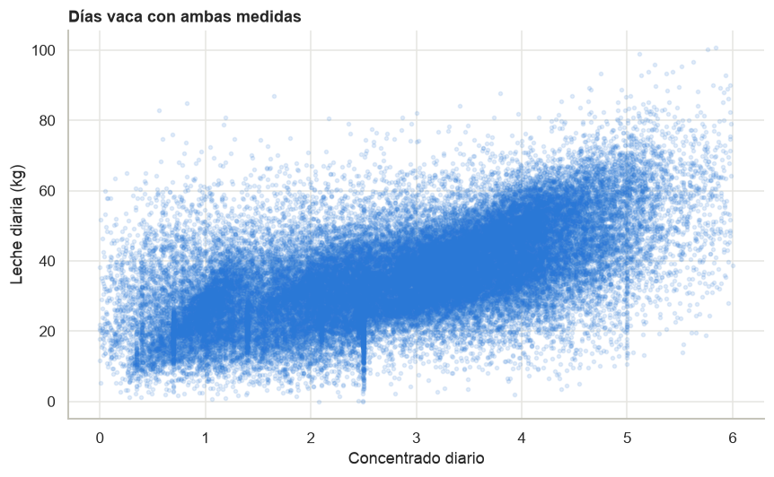

- La relación entre concentrado y leche ocurre el mismo día, lo que podría deberse a que ambas medidas dependen de cuántas visitas hizo la vaca ese día.

# **8. Reporte de calidad de los datos**

## 8.1 Resumen de calidad

| Indicador | Resultado |
| :---- | :---- |
| Duplicados exactos | 2 pares de rechazos de las 00:00 (se pueden eliminar sin perder información) |
| Sesiones repetidas entre csv y xlsx | 5,302 registros del csv de 2025 ya estaban en el xlsx con distinto formato de hora y duración; se quitan al cargar |
| Duplicados de vaca y hora (en `leche`) | 0 |
| Producción ≤ 0 kg / > 40 kg | 164 / 55 ordeños |
| Duración > 30 min | 31 ordeños |
| Intervalo ≤ 0 h / de 24 a 48 h / > 48 h | 0 / 2,444 / 420 (los de más de 48 h son regresos tras una brecha y se tratan como faltantes) |
| Suma de cuartos distinta del total (> 0.05 kg) | 9 ordeños (el total es menor que la suma de los cuartos) |
| Mediciones negativas | 0 |
| Brechas de 45 días o más sin registros | 248 brechas en 133 vacas (periodos secos) |
| Columnas vacías | `estado_rcs_1000_celulas_ml` (100 % nula) y `misc_usuario` (sin uso real) |

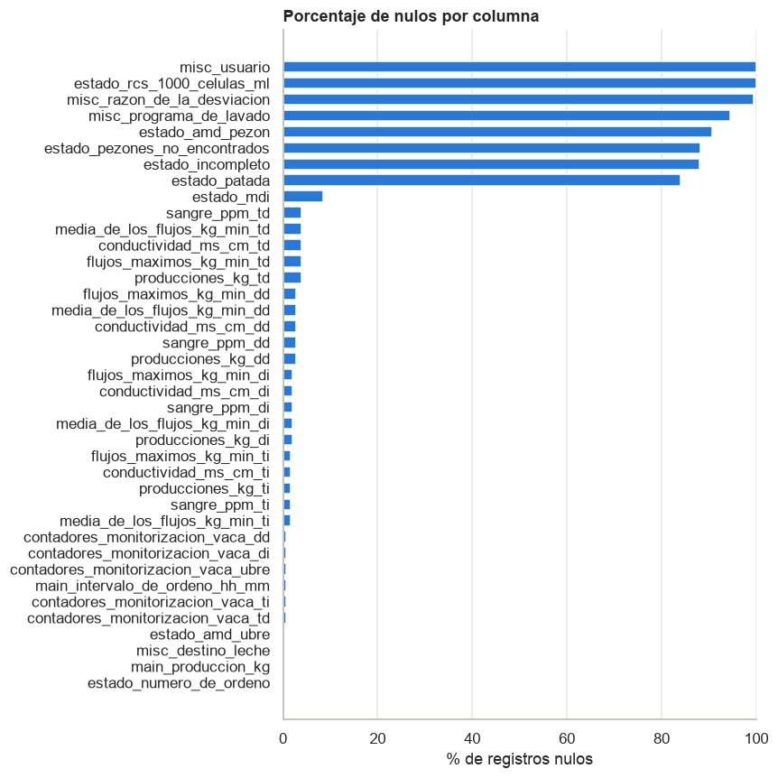

## 8.2 Tipos de nulo y tratamiento

El porcentaje por sí solo engaña: casi ningún nulo es un dato perdido.

| Tipo | Columnas | Qué significa | Tratamiento |
| :---- | :---- | :---- | :---- |
| Columna vacía (100 %) | `estado_rcs_1000_celulas_ml`, `misc_usuario` | No se registra el recuento de células somáticas ni el usuario | Eliminar |
| Casi vacía (99.5 %) | `misc_razon_de_la_desviacion` | Solo 1,542 registros con motivo del desvío (casi todos por sangre) | Categoría «Sin razón» / 0-1 |
| Casi vacía (94.4 %) | `misc_programa_de_lavado` | Solo trae «Local Aclarado» y solo en el xlsx | Eliminar; confirmar su significado |
| Nulo = «no ocurrió» (84 a 91 %) | `estado_patada`, `estado_incompleto`, `estado_pezones_no_encontrados`, `estado_amd_pezon` | La celda vacía significa que el evento no pasó | Convertir a 0/1, no imputar |
| Nulo estructural (0.08 %) | Todas las mediciones | Son las 216 visitas que no fueron ordeño | Separar por tipo de visita; no imputar |
| Columnas de una sola fuente (0.7 %) | `main_intervalo_de_ordeno_hh_mm`, `contadores_*`, `estado_mdi` | Solo existen en el xlsx (el `estado_mdi` falta además en 7.8 % del xlsx) | Calcular el intervalo con la hora de inicio |
| Cuarto no ordeñado | `*_di`, `*_dd`, `*_ti`, `*_td` | En 1 o 2 vacas por cuarto la medición falta en todos sus ordeños | Confirmar con el socio formador |
| Cero como nulo | `conductividad_ms_cm_*` | La conductividad no puede ser 0 (1.7, 3.2, 8.3 y 28.3 % en DI, DD, TI y TD) | Tratar como faltante |

## 8.3 Dos tipos de cero con tratamiento distinto

| Medición | Qué significa el 0 | Tratamiento |
| :---- | :---- | :---- |
| Producción del cuarto | Cuarto sin leche: dato real (en 10.2 % de los ordeños al menos un cuarto da 0 kg) | Se conserva; no se imputa porque acompaña a los eventos |
| Conductividad | Lectura que falló | Faltante (NaN) |

En DI el cero de conductividad coincide con el cuarto sin leche (4,638 ceros contra 4,521 cuartos sin leche), pero en DD y TI hay más ceros que cuartos sin leche (9,038 contra 4,229 y 23,282 contra 12,825), o sea ceros con leche, que son fallas de lectura. El caso más grave es el cuarto trasero derecho de la máquina `b96e85be`: 70,604 ceros (89 % de los de TD) contra 4,784 cuartos sin leche, lo que apunta a un sensor que no registra. En las otras dos máquinas los ceros de TD sí coinciden con los cuartos sin leche. Esto debe reportarse al cliente.

## 8.4 Ordeños con 0 kg y coherencia total contra cuartos

De los 164 ordeños con producción de 0 kg, en 149 (91 %) el robot reporta «Todos» los pezones como no encontrados, así que son visitas donde no se logró ordeñar y no un error de captura. En 9 ordeños la suma de los cuatro cuartos supera el total en más de 0.05 kg (por ejemplo 13.32 kg contra 8.60 kg); es una diferencia de registro del robot y son tan pocos que se pueden marcar sin afectar el análisis.

## 8.5 Decisiones de limpieza

| Decisión | Por qué |
| :---- | :---- |
| Unificar los dos formatos de fecha y duración | Las dos fuentes usan formatos distintos y el csv no trae segundos |
| Quitar del csv las sesiones que ya vienen en el xlsx (misma vaca y mismo minuto) | Se contarían dos veces; se conserva la fila del xlsx por tener segundos |
| Eliminar `estado_rcs_1000_celulas_ml`, `misc_usuario` y `misc_programa_de_lavado` | Vacías o con un solo valor, no aportan información |
| Convertir las alertas de texto a banderas 0/1 por cuarto | El texto guarda una lista de cuartos; un nulo es «no ocurrió» |
| Conductividad igual a 0 → faltante | Es físicamente imposible en leche |
| Intervalos de más de 48 h → faltante | No son intervalos de ordeño, son el regreso tras un periodo seco |
| No imputar los nulos estructurales ni los cuartos sin leche | La ausencia es información |
| Dejar fuera la máquina con 2 registros | Muy pocos datos, sin eventos |
| Conservar los ordeños con 0 kg y marcarlos | Casi todos son visitas sin ordeñar, útiles para el modelo |

## 8.6 Acciones de limpieza para la preparación de los datos

Lista de las acciones de limpieza que se derivan del EDA y de lo que requiere el modelado. La columna «Estado» indica si el notebook ya la aplica (secciones 2 y 20 de `final_data_understanding.ipynb`) o si queda para la fase de preparación de datos.

| # | Acción | Por qué | Estado |
| :---- | :---- | :---- | :---- |
| 1 | Convertir fechas, duración e intervalo a `datetime` y número; los intervalos de Excel se leen como fecha | Dos formatos de fecha y duración; los intervalos de 24 h o más vienen como `1900-01-01 hh:mm:ss` | Aplicada |
| 2 | Quitar las 5,302 sesiones repetidas entre csv y xlsx y los 2 duplicados exactos | Se contarían dos veces | Aplicada |
| 3 | Eliminar `estado_rcs_1000_celulas_ml`, `misc_usuario` y `misc_programa_de_lavado` | Vacías o con un solo valor | Aplicada en `df_modelo` |
| 4 | Separar los ordeños de los 216 rechazos y visitas de «echada sin ordeñar», y dejar fuera la máquina con 2 registros | Los rechazos no tienen producción ni mediciones; la máquina tiene muy pocos datos | Aplicada en el análisis; los rechazos se conservan aparte |
| 5 | Convertir las alertas de texto a banderas 0/1 por cuarto | El texto guarda una lista de cuartos (`DI,TD`, `Todos`) y el nulo significa «no ocurrió» | Aplicada en `df_modelo` |
| 6 | Tratar la conductividad igual a 0 como faltante; en el cuarto trasero derecho de `b96e85be` (89 % de sus ceros son avería del sensor), calcular la razón de conductividad (EC_Ratio) solo con los cuartos válidos o excluir ese cuarto en esa máquina | Es físicamente imposible; 28.3 % de ceros en TD | Ceros a faltante: aplicada. Regla del cuarto TD: por aplicar |
| 7 | Marcar los 420 intervalos de más de 48 h como «regreso tras periodo seco» (bandera) y dejar el intervalo en NaN | No son intervalos de ordeño | NaN: aplicada. Bandera: por aplicar |
| 8 | No imputar los cuartos sin leche ni los nulos estructurales; para MDI (8.4 % de nulos) y sensores, usar el manejo de nulos del propio modelo o imputar por vaca, sin imputación múltiple ciega | La ausencia es información y los nulos no son aleatorios | Cuartos y estructurales: aplicada. MDI y sensores: por aplicar |
| 9 | Conservar los 164 ordeños con 0 kg y marcarlos; marcar los 9 ordeños donde la suma de los cuartos no cuadra con el total | Casi todos los 0 kg son visitas sin ordeñar; las 9 diferencias son un error de registro | Por aplicar |
| 10 | No eliminar los atípicos; usar logaritmo o métodos robustos | Pueden ser justo las anomalías a detectar | Por aplicar |
| 11 | Calcular los rezagos y promedios móviles por vaca con desplazamiento de un ordeño, para no filtrar el presente, y reiniciarlos tras una ausencia de 45 días o más | Evita fuga de información; hay 248 brechas de 45 días o más en 133 vacas | Por aplicar |
| 12 | Excluir del historial por vaca a las que tienen menos de 30 registros | Tres vacas tienen muy poca historia para una línea base individual | Por aplicar |
| 13 | Alinear el clima con una hora de desfase, calcular el THI por hora y de ahí el máximo diario y sus rezagos | NASA POWER etiqueta cada hora una hora antes del clima que describe | Desfase y THI por hora: aplicada. Máximo diario y rezagos: por aplicar |
| 14 | Definir las clases (prioridad o etiquetas múltiples) antes de construir el objetivo | El incompleto y el pezón no encontrado coinciden en 79 a 80 % y los eventos se traslapan | Por aplicar, con el socio formador |
| 15 | Normalizar la sangre por máquina o marcarla | Picos de hasta 27.8 % de los ordeños en una máquina y máximos de 8,000 ppm | Por aplicar |

# **9. Datos atípicos**

Los atípicos se identificaron con la regla de 1.5 veces el rango intercuartil (IQR) y con umbrales físicos:

| Variable | Límites (IQR) | Atípicos | % de los ordeños | Valores extremos |
| :---- | :---- | ---: | ---: | :---- |
| Producción (kg) | 0.52 a 28.65 | 339 bajos y 3,508 altos | 1.37 % | Máximo 78.17 kg; 55 ordeños con más de 40 kg |
| Duración (min) | 1.52 a 14.12 | 14 bajos y 7,669 altos | 2.74 % | Máximo 55.8 min; 31 ordeños con más de 30 min |
| Intervalo (h) | 1.07 a 17.99 | 254 bajos y 9,919 altos | 3.63 % | 420 intervalos de más de 48 h (faltantes) |

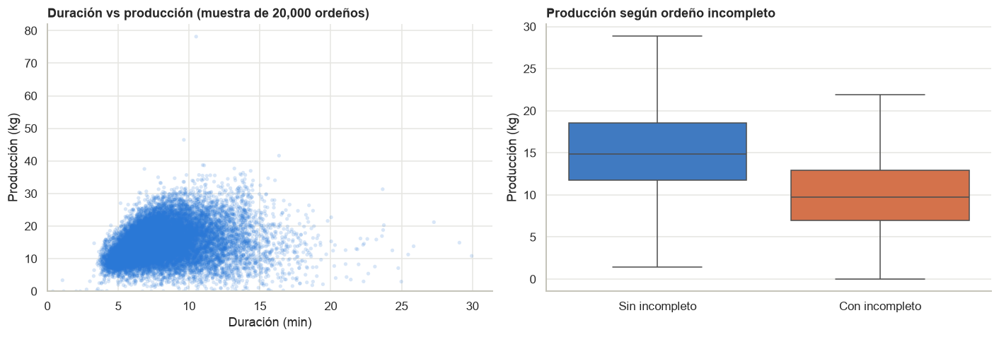

*Los ordeños con incompleto producen menos sin quedar aislados en duración: los atípicos no son un grupo separado sino la cola de una misma distribución.*

**Otros atípicos relevantes.**

- **Sangre:** `sangre_ppm_*` es casi siempre 0 y pasa de 1,000 ppm solo en 1.1 % de los ordeños; el máximo es 8,000 ppm.
- **MDI:** casi todos los valores están cerca de 1.1, con una cola hasta 15.36.
- **Por vaca:** 14,046 ordeños son más largos que el percentil 95 de su propia vaca, y 7,449 de ellos tienen además producción o flujo bajos.
- **Por máquina:** la máquina `7063e4b1` cae a unos 38 ordeños diarios a finales de marzo de 2024, y hay picos de sangre de hasta 27.8 % de los ordeños en el primer trimestre de 2024 en la misma máquina.

El tratamiento propuesto es no eliminarlos en esta fase: los atípicos de duración y producción pueden ser justamente las anomalías que se quieren detectar. Se deben transformar (logaritmo) o tratar con métodos robustos al modelar.

# **10. Contraste con los requerimientos del proyecto**

## 10.1 Requerimientos

| Requerimiento | Estado | Evidencia |
| :---- | :---- | :---- |
| Los datos contienen el identificador único de la vaca, datos del clima y el histórico de producción | **Cumple** | `id_vaca` sin nulos (207 vacas); clima para el 100 % de las sesiones; histórico de producción de julio de 2022 a enero de 2026 |
| Cada observación tiene asociado el identificador de la vaca | **Cumple** | 0 % de nulos en `id_vaca` |
| Variables del proceso de ordeño y otras que ayuden a identificar anomalías | **Cumple** | Duración, producción, flujo, conductividad, sangre, MDI, alertas por cuarto, destino de la leche, intervalo |
| Complementar con factores del ambiente | **Cumple** | NASA POWER (13 variables) e índice THI |
| Los datos del clima deben ser lo más precisos posible, con la ubicación del rancho | **Parcial** | Es una celda de NASA POWER de ½° × ⅝° (≈ 55 × 65 km), de exterior, y su hora viene desfasada una hora (se corrige). No mide el microclima del establo |
| Definir los tipos de evento que serán las clases objetivo | **Parcial** | Hay cuatro banderas (patada, incompleto, pezón no encontrado, AMD de pezón); el incompleto y el pezón no encontrado coinciden en 79 a 80 % y habría que decidir si son una o dos clases |
| Para cada alerta, mostrar la probabilidad de ordeño no exitoso y los 3 factores más influyentes | **Pendiente (modelado)** | Hay variables candidatas (evento previo de la vaca, intervalo, cuartos sin leche, conductividad) para explicar la probabilidad |
| Permiso para el uso de los datos | **No verificable en los datos** | Se asume según el consentimiento explícito |
| Proteger el acceso a los datos | **Cumple en el repositorio** | Vacas y máquinas anonimizadas con hash; `Data/` y el mapa de equivalencias quedan fuera del repositorio |
| Las causas asociadas a un ordeño incompleto las revisa el socio formador | **Pendiente** | Preguntas listadas en la sección 12 |

## 10.2 Supuestos

| Supuesto | Qué muestran los datos |
| :---- | :---- |
| El nombre de los archivos es el identificador de la vaca y los datos de producción son correctos, consistentes y completos | **Parcial.** Los identificadores coinciden entre ordeño y concentrado (201 de 207 vacas), pero hay duplicados entre fuentes, huecos por periodos secos y 28 % de ceros de conductividad en TD |
| Los datos del clima son precisos | **Parcial.** Cobertura de 100 %, pero con error y desfase de una hora (ver 10.1) |
| Existe relación entre el clima, la estacionalidad, la tendencia y los eventos | **Débil.** Correlaciones con los eventos de 0.026 o menos; efecto de −1 % en la producción en días calurosos; variación estacional de unos 10 % confundida con la lactancia |
| Existe información suficiente para distinguir entre los tipos de evento | **Parcial.** Los eventos son 12 a 16 % de los ordeños y el incompleto y el pezón no encontrado casi coinciden |

## 10.3 Criterios de éxito

Como el accuracy de un modelo que siempre responde «sin evento» ya es alto, el criterio de 80 % no basta:

| Objetivo de clasificación | Proporción de «sin evento» | Accuracy de «siempre sin evento» |
| :---- | ---: | ---: |
| Patada | 83.9 % | 83.9 % |
| Ordeño incompleto | 88.1 % | 88.1 % |
| Pezón no encontrado | 88.2 % | 88.2 % |
| Al menos uno de los cuatro eventos | 67.4 % | 67.4 % |

Para cada evento por separado, el accuracy de 80 % se supera sin aprender nada, así que debe complementarse con precisión, sensibilidad (*recall*) y F1, y con validación por vaca y por tiempo. Para «al menos un evento» el umbral de 80 % sí exige superar la línea base de 67.4 %.

## 10.4 Limitaciones

| Limitación | Contraste con los datos |
| :---- | :---- |
| Los datos recolectados se limitan al periodo 2025-2026 | Los datos de ordeño abarcan **desde julio de 2022**; solo el concentrado y los rechazos son de 2025-2026 |
| Puede existir desbalance entre sesiones normales y anómalas | **Confirmado:** los eventos son 12 a 16 % de los ordeños |
| Los datos provienen de una sola fuente (CAETEC) y de tres máquinas | **Confirmado:** tres máquinas con carga parecida |
| Los datos del clima se basan en predicciones | Se usa reanálisis y observación de NASA POWER; la decisión de usar pronóstico o clima observado al desplegar sigue pendiente |
| El desempeño depende del número de registros y la calidad | 280,697 ordeños; la calidad tiene tratamientos claros (sección 8) |

# **11. Implicaciones para la preparación y el modelado**

1. **Definir las etiquetas con cuidado.** El incompleto y el pezón no encontrado están casi fusionados; conviene decidir si son una o dos clases y no usar uno como predictor del otro.
2. **Cuidar la fuga de información.** Las variables medidas en la misma sesión (duración, producción, conductividad, flujo, cuartos con 0 kg, destino de la leche y razón de la desviación) pueden ser consecuencia del evento; para una alerta temprana hay que usar lo que se conoce antes (intervalo previo, historial de la vaca, clima).
3. **Aprovechar el historial de la vaca.** La persistencia es la señal más clara; las variables rezagadas por vaca (evento de la sesión anterior, tasa propia) son buenas candidatas.
4. **Validar por vaca y por tiempo**, no por sesión al azar: la identidad de la vaca explica gran parte de los eventos.
5. **Tratar los ceros de conductividad como faltantes** y los intervalos de más de 48 h también; no imputar los cuartos sin leche.
6. **Transformar las variables de cola larga** (logaritmo) o usar métodos robustos.
7. **Clima:** probarlo como variable de contexto (THI máximo del día, horas acumuladas y rezagos) y con al menos tres variables: nivel térmico, nubosidad o amplitud, y viento. No se espera que sea la señal principal.
8. **Métricas:** usar precisión, sensibilidad y F1 además del accuracy.
9. **Variables disponibles:** no hay multicolinealidad grave (VIF máximo de 2.84) ni conviene reducir dimensiones a priori (4 componentes para 80 % de la varianza).

# **12. Limitaciones y pendientes**

- No hay fecha de parto ni etiquetas de salud: la lactancia se aproxima por brechas de registro y la mastitis solo se aproxima con la conductividad y el MDI.
- El dataset no registra la llegada a la fila ni la espera, así que la cola solo se estima. Falta preguntar al CAETEC si existe algún registro de entrada de las vacas al corral de espera o a la puerta del robot.
- Los rechazos y las visitas de «echada sin ordeñar» solo existen en los datos de 2025.
- El clima es de exterior y de una celda de NASA POWER; no mide el microclima del establo.
- Los intervalos de confianza de las tasas suponen sesiones independientes y son optimistas.
- Falta confirmar con el socio formador: las pausas fijas de las 4, 12 y 20 h; el sensor de conductividad del cuarto trasero derecho de la máquina `b96e85be`; los picos de sangre y la caída de ordeños de la máquina `7063e4b1` en 2024; el umbral de conductividad (6.5 mS/cm es una referencia por confirmar); la definición exacta de `incomplete`, `teat_missing` y `kick`; si el robot reintenta tras un incompleto; la fecha de parto y de secado por vaca; la unidad del concentrado (la mediana por registro es 1.08, probablemente kg); y el significado de los contadores y del programa de lavado.
- Falta decidir si el modelo se despliega con pronóstico o con clima observado.

# **13. Adaptaciones de la metodología CRISP-DM**

En esta etapa de entendimiento de los datos se fusionaron los análisis exploratorios de cada integrante del equipo en un solo notebook para cubrir la mayor cantidad de información e inferencias posible. Las secciones que repetían el mismo análisis se conservaron en la versión más completa. La preparación de los datos (selección de variables, atributos derivados, separación en entrenamiento y prueba) queda para la siguiente fase.
